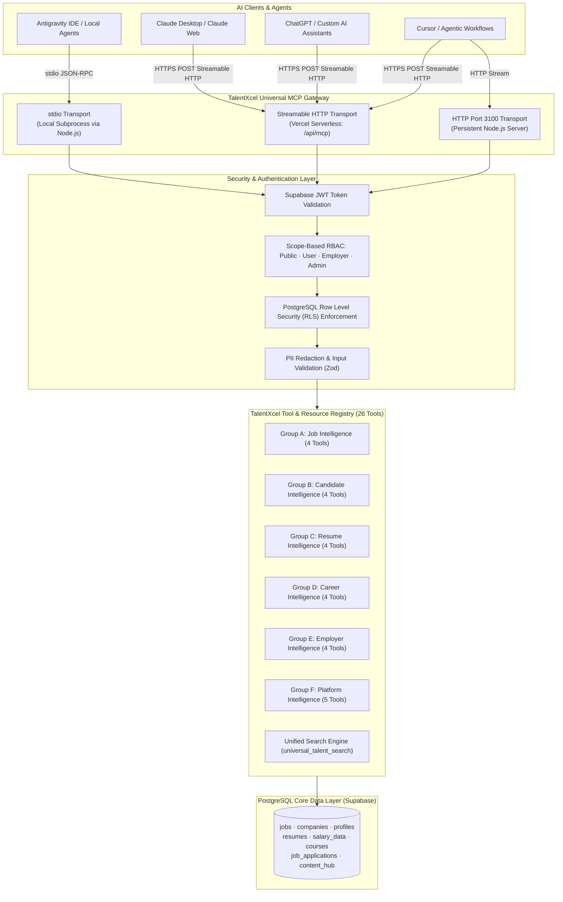

# TalentXcel Universal MCP Server — Architecture

## 1. System Architecture Overview

The **TalentXcel Universal MCP Server** exposes the complete TalentXcel career and recruitment intelligence layer to AI assistants (Claude, Antigravity, ChatGPT, Google Gemini, and custom agentic frameworks) via the open **Model Context Protocol (MCP)** standard.



---

## 2. Supported Transports & Deployment Models

### A. Local Development & Antigravity (`stdio`)
* **Transport:** `StdioServerTransport` from `@modelcontextprotocol/sdk/server/stdio.js`.
* **Execution:** Spawned as a child process by Antigravity or Claude Desktop.
* **Entry:** `talentxcel-mcp/dist/index.js`
* **Configuration:** Configured in `~/.gemini/config/mcp_config.json`.
* **Latency:** Sub-millisecond IPC; zero network hop to the local agent.

### B. Remote Production Endpoint (`Streamable HTTP`)
* **Transport:** `StreamableHTTPServerTransport` from `@modelcontextprotocol/sdk/server/streamableHttp.js`.
* **Target URL:** `https://talentxcel.in/api/mcp`
* **Implementation:** `api/mcp.ts` Vercel Serverless Function.
* **Stateless Model:** Each HTTP request initiates a compliant, isolated MCP session. This adheres directly to Vercel's serverless scaling constraints without requiring persistent daemon socket connections.
* **Limitations:** Multi-turn session resumption across disjoint serverless invocations is not supported by Vercel edge/serverless nodes. All tool execution, tool discovery (`tools/list`), prompt generation, and resource queries operate independently per request.

### C. Dedicated Node.js Service (Optional Persistent Mode)
* For deployments requiring continuous Server-Sent Events (SSE) or long-lived persistent sessions, `talentxcel-mcp/` can be run continuously on Node.js / Docker via:
  ```bash
  npm run start:http
  ```
  listening on port 3100 with full session affinity.

---

## 3. Data Integrity & Verification

In accordance with production guidelines:
* **Zero Synthetic Data:** All tools query live PostgreSQL tables (`jobs`, `companies`, `profiles`, `resumes`, `salary_data`, `courses`, `content_hub`, `notifications`).
* **Column Alignment:** Tool queries map directly to verified schemas generated in `src/integrations/supabase/types.ts`.
* **No Service-Role Key Leakage:** Client requests execute using the user's authenticated bearer JWT, ensuring Supabase Row Level Security (RLS) is strictly enforced at the database level.
