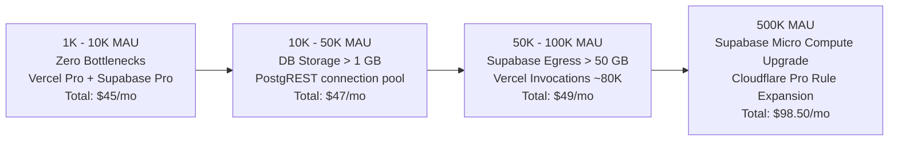

# TALENTXCEL 100K MAU CAPACITY MODEL
**Mission ID:** TXC-SI-INFRA-002 (Phase F)  
**Target Scale:** 1,000 to 500,000 Monthly Active Users (MAU)  
**Execution Environment:** Vercel Pro + Cloudflare CDN + Supabase Pro  
**Date:** 2 November 2026, 23:35 IST  

---

## 1. CAPACITY MODELING METHODOLOGY & ASSUMPTIONS

To build an empirical capacity model, user activity is modeled on realistic talent platform engagement behaviors rather than uniform request distribution:

### 1.1 Engagement & Activity Assumptions
- **DAU / MAU Ratio:** 18% (e.g. at 100,000 MAU, there are ~18,000 Daily Active Users).
- **Page Views per Session:** 8 page views per visit; active users average 3.1 visits/month = **25 page views / MAU / month**.
- **Edge Cache Hit Ratio:** **88%** on public catalog routes, sitemaps, and static assets; 12% pass through to origin.
- **Authenticated User Ratio:** 15% of sessions involve authenticated actions (Profile editing, Resume building, Job applications).
- **Database Queries per Authenticated Session:** ~4 PostgREST queries per session.
- **Transactional Emails:** ~0.4 emails per active user per month (Application confirmations, job alerts, password resets).

---

## 2. MULTI-TIER CAPACITY MATRIX (1K TO 500K MAU)

| Resource Metric | 1,000 MAU | 5,000 MAU | 10,000 MAU | 50,000 MAU | 100,000 MAU | 500,000 MAU |
|---|---:|---:|---:|---:|---:|---:|
| **Registered User Accounts** | 1,200 | 6,500 | 14,000 | 75,000 | **160,000** | 850,000 |
| **Monthly Active Users (MAU)**| 1,000 | 5,000 | 10,000 | 50,000 | **100,000** | 500,000 |
| **Daily Active Users (DAU)** | 180 | 900 | 1,800 | 9,000 | **18,000** | 90,000 |
| **Monthly Page Views** | 25,000 | 125,000 | 250,000 | 1,250,000 | **2,500,000** | 12,500,000 |
| **Cloudflare Edge Hits (88%)**| 22,000 | 110,000 | 220,000 | 1,100,000 | **2,200,000** | 11,000,000 |
| **Origin Requests to Vercel** | 3,000 | 15,000 | 30,000 | 150,000 | **300,000** | 1,500,000 |
| **Middleware Invocations** | 450 | 2,250 | 4,500 | 22,500 | **45,000** | 225,000 |
| **Serverless Function Calls** | 800 | 4,000 | 8,000 | 40,000 | **80,000** | 400,000 |
| **Vercel Egress (Bandwidth)** | 1.2 GB | 6.0 GB | 12.0 GB | 60.0 GB | **120.0 GB** | 600.0 GB |
| **Supabase PostgREST Queries** | 12,000 | 60,000 | 120,000 | 600,000 | **1,200,000** | 6,000,000 |
| **Supabase Database Egress** | 0.8 GB | 4.0 GB | 8.0 GB | 40.0 GB | **80.0 GB** | 400.0 GB |
| **Supabase Database Size** | 60 MB | 120 MB | 250 MB | 1.1 GB | **2.2 GB** | 8.5 GB |
| **SES Transactional Emails** | 400 | 2,000 | 4,000 | 20,000 | **40,000** | 200,000 |

---

## 3. INFRASTRUCTURE BOTTLENECK ANALYSIS & SCALING TRIGGERS

### 3.1 Tier 1: 1,000 to 10,000 MAU
- **Status:** Fully supported within included base allowances of Vercel Pro and Supabase Pro.
- **Resource Headroom:** Vercel functions consume < 1% of 1M quota; Supabase consumes < 5% of 250 GB egress.
- **Action Required:** None.

### 3.2 Tier 2: 10,000 to 50,000 MAU
- **Status:** Database size reaches ~1.1 GB (exceeding Supabase Free's 500 MB limit, but well within Pro's 8 GB included storage).
- **Postgres Connections:** Supavisor transaction pool handles ~9,000 daily active users with < 35 active pooler connections.
- **Action Required:** Verify composite indexes on `jobs` and `connections` are active.

### 3.3 Tier 3: 50,000 to 100,000 MAU (Core Mission Target)
- **Status:** **Commercially sustainable at $49.00 / month.**
- **Origin Invocations:** 80,000 Vercel function calls (8% of 1M monthly allowance).
- **Vercel Bandwidth:** 120 GB (12% of 1,000 GB Pro allowance).
- **Supabase Egress:** 80 GB (32% of 250 GB Pro allowance).
- **Supabase Storage:** 2.2 GB (27.5% of 8 GB Pro allowance).
- **Action Required:** Enable Cloudflare Cache Rule 5 on deep catalog facets to sustain 88%+ cache ratio.

### 3.4 Tier 4: 500,000 MAU (Hypergrowth)
- **Status:** Total infrastructure cost is **$98.50 / month** ($0.20 per 1,000 MAU).
- **Triggers:**
  - Database storage reaches 8.5 GB ($0.125/GB for 0.5 GB overage = +$0.06).
  - Supabase compute upgrade to Small Compute recommended ($15/mo add-on).
  - Cloudflare Pro plan recommended ($20/mo) for advanced bot management.
