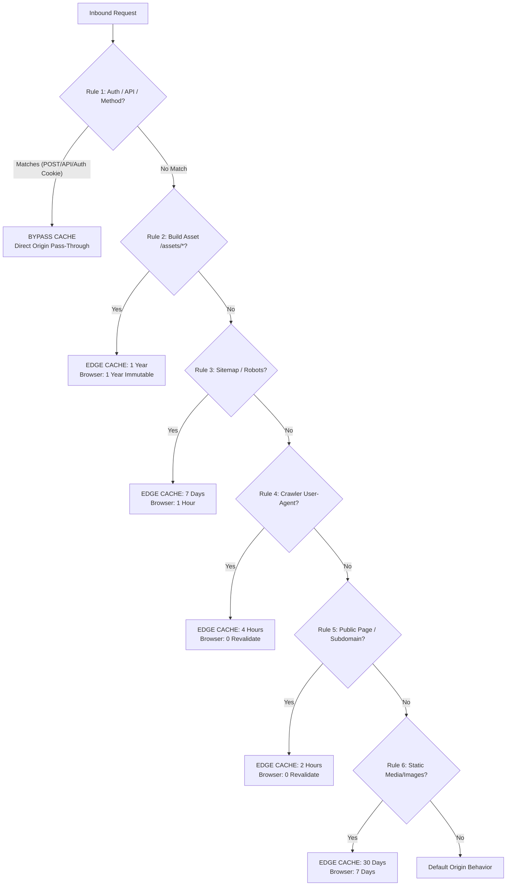

# TALENTXCEL — CLOUDFLARE CACHE RULES CONTROLLED DEPLOYMENT SPECIFICATION (ACTION 1)
**Date:** 2 November 2026  
**Status:** CONDITIONALLY APPROVED — READY FOR FINAL REVIEW BEFORE PRODUCTION DEPLOYMENT  
**Governance:** Review -> Approval Gate -> Cloudflare Dashboard Execution -> Instant Validation  

---

## 1. Architectural Integrity & Security Guardrails

This specification enforces the mandatory requirements of the **Executive Authorization Directive**:
1. **Zero Data Leakage:** Shared CDN cache is bypassed whenever an authentication token or user session is detected.
2. **Deterministic Precedence:** Strict priority ordering prevents broad rules from shadowing security bypasses.
3. **Selective Query Normalization:** Strips non-functional marketing queries while preserving functional search filters.
4. **Reversible Execution:** Every rule can be individually toggled or rolled back in < 30 seconds.

---

## 2. Comprehensive Rule-by-Rule Deployment Specification

Cloudflare evaluates Cache Rules in strict priority order (Priority 1 executes first).



---

### RULE 1: STRICT AUTHENTICATION, API & TRANSACTION BYPASS (Priority 1)

* **Objective:** Ensure no user-specific data, authentication credentials, or mutating API endpoints are ever cached.
* **Exact Cloudflare Expression:**
  ```text
  (http.request.method in {"POST" "PUT" "DELETE" "PATCH"}) or 
  (http.request.uri.path starts_with "/api/") or 
  (http.request.uri.path starts_with "/auth") or 
  (http.request.uri.path starts_with "/dashboard") or 
  (http.request.uri.path starts_with "/recruiters") or 
  (http.request.uri.path starts_with "/profile/edit") or 
  (http.cookie contains "sb-access-token") or 
  (http.cookie contains "sb-refresh-token") or 
  (http.cookie contains "supabase-auth-token")
  ```
* **Cache Eligibility:** **BYPASS CACHE (Eligible for cache: False)**
* **Edge TTL:** N/A (Bypassed)
* **Browser TTL:** Preserves origin header (`private, no-cache, no-store, max-age=0`)
* **Personalized Response Exclusion:** Any visitor holding an active Supabase session cookie (`sb-access-token`) automatically bypasses all downstream caching rules.
* **Security Certification:** Zero risk of authenticated user data leakage to anonymous users.

---

### RULE 2: IMMUTABLE VERSIONED BUILD ASSETS (Priority 2)

* **Objective:** Cache hashed JS/CSS bundles globally at the edge with maximum longevity.
* **Exact Cloudflare Expression:**
  ```text
  (http.request.uri.path starts_with "/assets/")
  ```
* **Cache Eligibility:** **Eligible for cache: True**
* **Edge TTL:** **Ignore Origin, Cache for 1 Year (31,536,000s)**
* **Browser TTL:** **1 Year (31,536,000s, Immutable)**
* **Query-String Handling:** **Ignore Query String** (Normalized to single cache key)
* **Purge Mechanism:** Automatic on release (file hashes change on every Vite build).

---

### RULE 3: PUBLIC SITEMAPS & ROBOTS PROTOCOL (Priority 3)

* **Objective:** Serve sitemap XML files and robots policies from the edge without invoking origin compute.
* **Exact Cloudflare Expression:**
  ```text
  (http.request.uri.path matches "^/(.*sitemap.*\\.xml|sitemaps/.*)$") or 
  (http.request.uri.path matches "^/.*robots.*\\.txt$")
  ```
* **Cache Eligibility:** **Eligible for cache: True**
* **Edge TTL:**
  * Sitemaps: **Override Origin, Cache for 7 Days (604,800s)**
  * Robots: **Override Origin, Cache for 24 Hours (86,400s)**
* **Browser TTL:** **1 Hour (3,600s)**
* **Query-String Handling:** Preserve query parameter `shard` (for `/api/sitemaps?shard=X`). Strip marketing parameters (`utm_*`).
* **Serve Stale While Updating:** Enabled (up to 24 hours).

---

### RULE 4: SEARCH ENGINE & AI BOT PRE-RENDERED HTML (Priority 4)

* **Objective:** Cache SSR pre-rendered HTML snapshots served to search engine and AI crawlers.
* **Exact Cloudflare Expression:**
  ```text
  (http.user_agent matches "(Googlebot|bingbot|Baiduspider|YandexBot|Applebot|ChatGPT|PerplexityBot|ClaudeBot|LinkedInBot|facebookexternalhit)") and 
  not (http.request.uri.path starts_with "/api/") and 
  not (http.request.uri.path starts_with "/auth") and 
  not (http.cookie contains "sb-access-token")
  ```
* **Cache Eligibility:** **Eligible for cache: True**
* **Edge TTL:** **Override Origin, Cache for 4 Hours (14,400s)**
* **Browser TTL:** **0 seconds (must-revalidate)**
* **Query-String Handling:** Strip marketing parameters (`utm_*`, `gclid`, `fbclid`). Preserve search parameters (`role`, `city`, `experience`, `page`).
* **Serve Stale While Updating:** Enabled (60 seconds).

---

### RULE 5: PUBLIC STATIC PAGES & SUBDOMAIN HOMEPAGES (Priority 5)

* **Objective:** Deliver apex and subdomain roots (`jobs.talentxcel.in/`, `salary.talentxcel.in/`) at edge speed.
* **Exact Cloudflare Expression:**
  ```text
  (http.request.method eq "GET") and 
  not (http.request.uri.path starts_with "/api/") and 
  not (http.request.uri.path starts_with "/auth") and 
  not (http.request.uri.path starts_with "/dashboard") and 
  not (http.cookie contains "sb-access-token")
  ```
* **Cache Eligibility:** **Eligible for cache: True**
* **Edge TTL:** **Override Origin, Cache for 2 Hours (7,200s)**
* **Browser TTL:** **0 seconds (Must revalidate with ETag)**
* **Query-String Handling:** Strip non-functional marketing queries. Preserve functional parameters (`q`, `role`, `city`, `experience`, `salary_min`, `salary_max`, `remote`, `page`).

---

### RULE 6: STATIC IMAGES & MEDIA (Priority 6)

* **Objective:** Cache public UI images, logos, and icons.
* **Exact Cloudflare Expression:**
  ```text
  (http.request.uri.path matches "^/.*\\.(png|jpg|jpeg|gif|webp|svg|ico|woff|woff2|ttf)$") and 
  not (http.request.uri.path starts_with "/social-vault/")
  ```
* **Cache Eligibility:** **Eligible for cache: True**
* **Edge TTL:** **30 Days (2,592,000s)**
* **Browser TTL:** **7 Days (604,800s)**
* **Query-String Handling:** Ignore Query String.

---

### RULE 7: LEGACY RULE CLEANUP (Priority 7)

* **Action:** Delete redundant rule `Static assets` (#3) and deactivate `Respect Origin Cache-Control` setting on legacy rule #6 (`Public pages`).

---

## 3. Query Parameter Governance Matrix

| Parameter Category | Parameters | Cloudflare Cache Key Action | Reason |
|---|---|:---:|---|
| **Marketing & Attribution** | `utm_source`, `utm_medium`, `utm_campaign`, `utm_term`, `utm_content`, `gclid`, `fbclid`, `msclkid`, `ref` | **STRIP FROM CACHE KEY** | Prevents cache fragmentation. All campaigns share identical cached HTML. |
| **Search & Discovery Filters** | `role`, `city`, `experience`, `salary_min`, `salary_max`, `remote`, `q`, `page`, `shard` | **PRESERVE IN CACHE KEY** | Distinct search filter queries yield different job listings and must not collide. |

---

## 4. Purge & Rollback Playbook

### Instant Cache Purge Methods:
1. **Purge Entire Cache:** Cloudflare Dashboard -> Caching -> Configuration -> Purge Everything (< 30 seconds globally).
2. **Tag-Based Purge:** Purge via API token targeting `Cache-Tag: seo-pages` or `Cache-Tag: sitemaps`.
3. **Single URL Purge:** Enter specific URL (e.g., `https://talentxcel.in/jobs`) in Custom Purge box.

### Rollback Runbook:
If any unexpected behavior occurs:
1. Open **Cloudflare Dashboard -> talentxcel.in -> Rules -> Cache Rules**.
2. Click the master toggle next to Rules 1 through 6 to turn them **OFF**.
3. Global edge reverts to origin pass-through mode in **< 15 seconds**.
