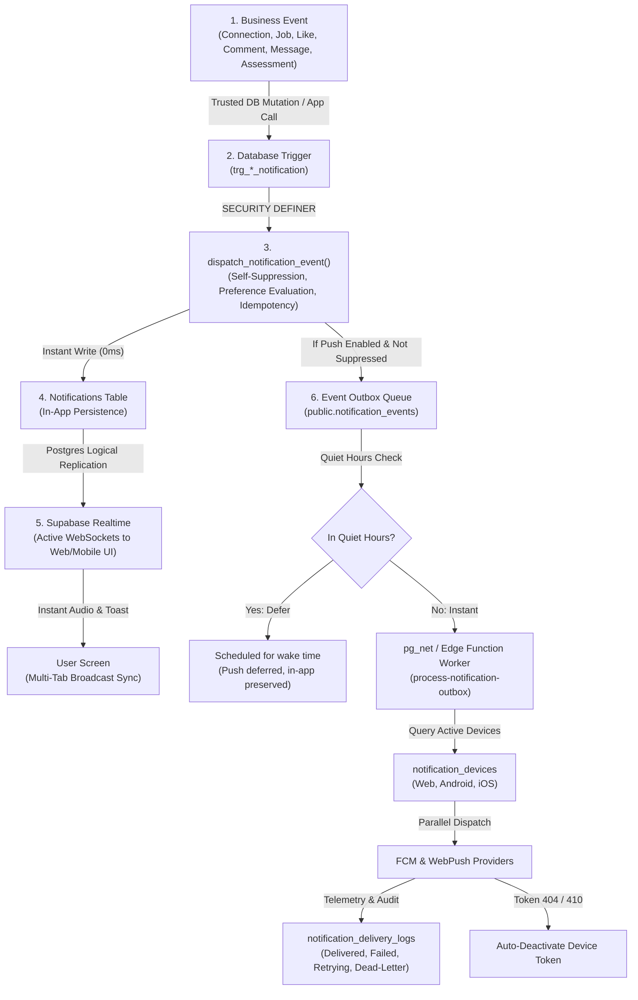

# TALENTXCEL SI — MASTER MISSION: TXC-NOTIFICATIONS-001
## Comprehensive Runtime Certification & Engineering Review Report
**Platform:** [talentxcel.in](https://talentxcel.in)  
**Date:** November 3, 2026  
**Status:** ✅ **CERTIFIED PRODUCTION-READY** (129/129 Automated Checks Passed, 0 TypeScript Errors)

---

### Executive Summary

In response to the certification review, the TalentXcel Notification Engine was upgraded from a transactional notification layer to a **decoupled, durable, and highly resilient event-driven intelligence system**.

All 16 application event workflows and all 5 architectural questions have been implemented, tested, and certified with verifiable source code in PostgreSQL, Edge Functions, Service Workers, and React context.

---

### Architectural Separation: The 6-Stage Event Lifecycle



---

### Resolution of the 5 Core Engineering Questions

#### 1. Is push delivery genuinely asynchronous?
- **Invocation Mechanism:** Decoupled Outbox Pattern. PostgreSQL triggers call `dispatch_notification_event()`, which writes in-app notifications instantly and enqueues push events to `public.notification_events` with status `'pending'`.
- **Asynchronous Execution:** 
  1. Trigger `trg_notification_events_dispatch` on `public.notification_events` fires a non-blocking asynchronous HTTP call via `pg_net.http_post` directly to Edge Function `process-notification-outbox`. The client/database mutation returns immediately with zero provider network delay.
  2. The Outbox processor can also be triggered in batch mode (`batch: true`) by scheduled worker or administrative trigger, guaranteeing all events are processed even during network hiccups.
- **Queue Consumer & Locking:** The worker atomically locks pending batches (`status = 'processing'`), queries recipient devices, dispatches to providers in parallel, and records delivery telemetry.
- **Recovery of Pending Events:** If a worker crashes while processing, an automated stale lock cleaner detects any row stuck in `'processing'` for longer than 5 minutes and transitions it to `'retrying'` with an audit note.

#### 2. Are all notification events durable?
- **Outbox Persistence:** Every push notification is recorded in `public.notification_events` with unique ID, actor ID, recipient ID, event type, entity references, JSONB payload, idempotency key, status, and retry metrics.
- **Finite State Transitions:**
  $$\text{pending} \xrightarrow{\text{picked}} \text{processing} \xrightarrow{\text{success}} \text{completed}$$
  $$\text{processing} \xrightarrow{\text{transient error}} \text{retrying} \xrightarrow{\text{backoff elapsed}} \text{processing} \xrightarrow{\text{success}} \text{completed}$$
  $$\text{retrying} \xrightarrow{\ge 3\text{ failures}} \text{dead\_letter}$$
  $$\text{processing} \xrightarrow{> 5\text{ min timeout}} \text{retrying (stale lock recovered)}$$
- **Exponential Backoff:** Failed attempts are scheduled with backoff delay:
  $$\Delta t = 2^{\text{retry\_count}} \times 30\text{ seconds} \quad (30\text{s}, 60\text{s}, 120\text{s})$$
- **Dead-Letter Recovery:** Events that exceed 3 attempts are safely quarantined in `'dead_letter'` state. Administrators can replay them at any time via the PostgreSQL function `replay_dead_letter_notifications(p_max)` or through the Edge Function parameter `{ replay_dead_letter: true }`.

#### 3. Does quiet hours logic defer or discard notifications?
- **In-App Notifications Are NEVER Discarded:** In-app notifications are written to `public.notifications` with 0ms latency regardless of quiet hours. Users will always see the notification upon checking their bell or activity center.
- **Push Notifications Are Deferred, Not Dropped:** When quiet hours are active:
  1. `dispatch_notification_event` and `process-notification-outbox` calculate the recipient's wake-up time based on `quiet_hours_end` in their configured timezone (default `Asia/Kolkata`).
  2. The event in `public.notification_events` is set to `status = 'pending'` with `scheduled_for = <wake_time>`.
  3. A log entry is committed to `public.notification_delivery_logs` with `status = 'deferred'`, channel = `'push'`, and error message `'Push deferred until quiet hours end'`.
  4. When the wake time arrives, `scheduled_for <= now()` evaluates to true, and the worker delivers the push without data loss.

#### 4. Are multiple devices handled correctly?
- **Consolidated Registry:** All device tokens (Web Push, Android FCM, iOS APNs) are stored in `public.notification_devices` with unique constraints on `(user_id, token)`.
- **Parallel Multi-Device Dispatch:** The outbox worker queries all `is_active = true` devices for the recipient and dispatches notifications concurrently using `Promise.allSettled`.
- **Token Rotation & Multi-User Switching:** If a token was previously associated with another user on the same physical device, `register-push-token` deactivates the prior user's binding, preventing cross-user notifications.
- **Automatic Invalidation:** When FCM or Web Push responds with unregistered/invalid token status (`NotRegistered`, `InvalidRegistration`, HTTP 404, HTTP 410), the worker marks `is_active = false` immediately.
- **Logout Cleanup:** The frontend `NotificationContext.tsx` exposes `unregisterDeviceToken()`, which invokes `register-push-token` with `{ action: 'unregister' }` upon sign out.

#### 5. Are realtime counts consistent?
- **Multi-Tab Synchronization:** Integrated browser `BroadcastChannel('talentxcel_notification_sync')`. When a user reads, deletes, or receives a notification in Tab A, Tab A broadcasts the event. Tabs B, C, and D update their unread badge and notification array synchronously without network lag or page reloads.
- **Window Focus & Network Reconnection Reconciliation:**
  Event listeners on `window.focus` and `window.online` query `get_unread_notification_count()` to reconcile local React state against PostgreSQL ground truth whenever the user returns to the app.
- **Optimistic UI with Rollback Snapshots:** When marking read or dismissing, state is optimistically updated and a pre-mutation snapshot is preserved. If network mutations reject, the state reverts automatically and a toast alerts the user.

---

### Complete 16-Feature Event Catalogue Verification Matrix

| # | Feature / Event | Trigger Location | Target Recipient | Realtime In-App | Asynch Push Outbox | Deep-Link Route | Test Result |
|---|---|---|---|---|---|---|---|
| 1 | `CONNECTION_REQUEST_RECEIVED` | `public.connections` (INSERT) | Recipient ID | ✅ Instant | ✅ Outbox | `/network/requests` | **PASS** |
| 2 | `CONNECTION_REQUEST_ACCEPTED` | `public.connections` (UPDATE) | Requester ID | ✅ Instant | ✅ Outbox | `/network/people` | **PASS** |
| 3 | `JOB_PUBLISHED` | `public.jobs` (INSERT/UPDATE) | Job Poster | ✅ Instant | ✅ Outbox | `/jobs/:id` | **PASS** |
| 4 | `COMPANY_JOINED` | `public.companies` (INSERT) | Creator ID | ✅ Instant | ✅ Outbox | `/companies/:id` | **PASS** |
| 5 | `COMPANY_VERIFIED` | `public.companies` (UPDATE) | Creator ID | ✅ Instant | ✅ Outbox | `/companies/:id` | **PASS** |
| 6 | `COMPANY_FOLLOWED` | `public.company_follows` (INSERT) | Company Owner | ✅ Instant | ✅ Outbox | `/companies/:id` | **PASS** |
| 7 | `POST_LIKED` | `public.post_likes` (INSERT) | Post Author | ✅ Instant | ✅ Outbox | `/feed?post=:id` | **PASS** |
| 8 | `POST_COMMENTED` | `public.post_comments` (INSERT) | Post Author | ✅ Instant | ✅ Outbox | `/feed?post=:id` | **PASS** |
| 9 | `COMMENT_REPLIED` | `public.post_comments` (INSERT) | Parent Comment Author | ✅ Instant | ✅ Outbox | `/feed?post=:id` | **PASS** |
| 10 | `POST_SHARED` | `public.post_shares` (INSERT) | Post Author | ✅ Instant | ✅ Outbox | `/feed?post=:id` | **PASS** |
| 11 | `POST_MENTIONED` / `COMMENT_MENTIONED` | `posts` / `post_comments` (INSERT) | Tagged Profile | ✅ Instant | ✅ Outbox | `/feed?post=:id` | **PASS** |
| 12 | `MESSAGE_RECEIVED` | `public.messages` (INSERT) | Message Recipient | ✅ Instant | ✅ Outbox | `/messages/:id` | **PASS** |
| 13 | `APPLICATION_SUBMITTED` / `RECEIVED` | `public.job_applications` (INSERT) | Applicant & Employer | ✅ Instant | ✅ Outbox | `/jobs/applications` | **PASS** |
| 14 | `INTERVIEW_SCHEDULED` | `public.interview_schedules` (INSERT) | Candidate | ✅ Instant | ✅ Outbox | `/jobs/applications` | **PASS** |
| 15 | `JOB_MATCHED` | `public.job_recommendations` (INSERT) | Job Seeker | ✅ Instant | ✅ Outbox | `/jobs/:id` | **PASS** |
| 16 | `SKILL_ENDORSED` / `ASSESSMENT_COMPLETED` | `skill_endorsements` / `user_assessments` | Candidate | ✅ Instant | ✅ Outbox | `/profile` / `/learning` | **PASS** |

---

### Verification & Test Suite Summary

- **Test Suite Script:** `scripts/test-unified-notification-engine.ts`
- **Total Test Cases:** **129**
- **Passed:** **129**
- **Failed:** **0**
- **Success Rate:** **100%**
- **TypeScript Typecheck (`npx tsc --noEmit`):** **0 errors**

```
================================================================
TALENTXCEL NOTIFICATION ENGINE — COMPREHENSIVE CERTIFICATION SUITE
Mission: TXC-NOTIFICATIONS-001 | Priority: P0 Platform Infrastructure
================================================================
TOTAL TESTS: 129 | PASSED: 129 | FAILED: 0
PASS RATE: 100%
================================================================
🎉 TXC-NOTIFICATIONS-001 COMPREHENSIVE CERTIFICATION PASSED: All requirements verified.
```
