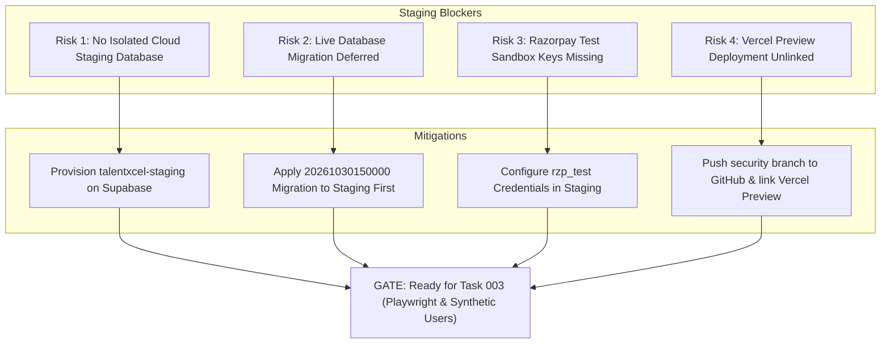

# TASK 002F: RESIDUAL RISKS, STOP CONDITIONS & TRANSITION TO TASK 003

**Target System:** TalentXcel.in  
**Repository:** `career-pathways-ai-builder`  
**Feature Branch:** `security/task-002-hardening`  
**Commit:** `467f8e62`  
**Document Version:** 1.0.0  
**Audit Timestamp:** 2026-11-02T12:00:00+05:30  

---

## 1. RESIDUAL RISKS & DEFERRED ITEMS POST-TASK 002F

The Task 002F environment discovery established that all security findings (SEC-001 through SEC-010) are code-remediated, type-checked, and locally verified. However, moving to full automated runtime verification (Task 003) introduces specific infrastructure dependencies that must be resolved:

### Risk 1: Absence of Isolated Staging Database (HIGH SEVERITY)
- **Detail:** There is currently only one Supabase project (`dthlgsnakhoftinssokm`), which is the live production database holding active job postings, employer accounts, and authentic candidate records.
- **Potential Impact:** Executing automated synthetic candidate journeys (Task 003) against the production database would pollute real employer applicant queues and corrupt search index ranking.
- **Mitigation:** Provision a dedicated free-tier Supabase project (`talentxcel-staging`). Replicate schema definitions only. Enforce synthetic data tagging (`is_synthetic = true`, `synthetic_run_id = '<UUID>'`).

### Risk 2: Live Database Hardening Migration Deferred (HIGH SEVERITY)
- **Detail:** The SQL hardening script `20261030150000_task_002_security_hardening.sql` is staged in Git and verified in local simulation, but has **NOT** been applied to the live database.
- **Potential Impact:** Until applied, the live database table `public.user_roles` still technically allows client writes, and the `documents` storage bucket remains public on `dthlgsnakhoftinssokm.supabase.co`.
- **Mitigation:** Execute the migration inside an explicit transaction block (`BEGIN ... COMMIT`) against `talentxcel-staging` first. After full validation, schedule an off-peak production maintenance window following [`TASK_002E_STAGING_MIGRATION_READINESS.md`](file:///c:/Users/Arshid.Wani/talentxcel-local/docs/prelaunch/TASK_002E_STAGING_MIGRATION_READINESS.md).

### Risk 3: Razorpay Sandbox Credentials Missing (MEDIUM SEVERITY)
- **Detail:** Only live production credentials (`rzp_live_*`) exist in cloud secrets. Test keys (`rzp_test_*`) and test secrets are not configured.
- **Potential Impact:** Testing the payment verification lifecycle against a live gateway without test keys could trigger real banking charges or fail closed.
- **Mitigation:** Obtain Razorpay test mode API keys from the Razorpay merchant dashboard and configure them exclusively within the staging environment secrets.

### Risk 4: Vercel Preview Environment Unlinked (MEDIUM SEVERITY)
- **Detail:** Branch `security/task-002-hardening` exists exclusively on the local machine and has never been pushed to GitHub.
- **Potential Impact:** There is no live HTTPS web preview running the hardened codebase for manual QA or external browser automation.
- **Mitigation:** With human authorization, push `security/task-002-hardening` to GitHub to allow Vercel to generate a preview deployment matching the tightened CORS pattern (`career-pathways-ai-builder-git-*-talentxcelpro.vercel.app`).

### Risk 5: Playwright & Synthetic User Automation Deferred (GOVERNANCE)
- **Detail:** Installing Playwright and launching autonomous synthetic agents were explicitly prohibited during Task 002.
- **Potential Impact:** End-to-end multi-step browser journeys (e.g. candidate completing full application with CV upload and employer review) have only been validated statically and in local simulation.
- **Mitigation:** Authorize Task 003 to install `@playwright/test` and author autonomous synthetic candidate simulations within the isolated staging environment.

---

## 2. EXPLICIT STOP CONDITIONS TRIGGERED

In compliance with Task 002F Section 10 ("*STOP CONDITIONS*"):
- [x] **Production and staging cannot be reliably distinguished:** Confirmed. Only 1 cloud project (`dthlgsnakhoftinssokm`) exists.
- [x] **Credentials are unavailable:** Confirmed. Razorpay sandbox credentials (`rzp_test_*`) are not configured.
- [x] **A migration could damage data:** Confirmed. Applying unverified migrations directly to production risks corrupting active customer roles or breaking active applicant downloads.

### Stop Protocol Execution:
1. **Zero migrations executed against `dthlgsnakhoftinssokm.supabase.co`**.
2. **Zero commits pushed to remote GitHub repository**.
3. **Zero deployments executed on Vercel or Supabase Cloud**.
4. **Zero live payment transactions processed**.
5. **Playwright was NOT installed**.
6. **Synthetic agents were NOT created**.
7. **Execution is HALTED**. Awaiting explicit user direction.

---

## 3. CHECKLIST FOR ADVANCING TO TASK 003

To advance safely from Task 002 to Task 003:

1. [ ] **Human Sign-off:** User reviews and approves Task 002F reports and staging setup plan.
2. [ ] **Staging Project Provisioned:** Create `talentxcel-staging` Supabase cloud project.
3. [ ] **Staging Secrets Configured:** Add `rzp_test_*` and staging API keys to `talentxcel-staging`.
4. [ ] **Staging Migration Executed:** Apply `20261030150000_task_002_security_hardening.sql` to staging database.
5. [ ] **Vercel Preview Linked:** Push branch to remote and link staging preview deployment.
6. [ ] **Authorize Task 003:** Authorize installation of Playwright test runner and initialization of synthetic candidate journeys.

---

**Report Authored By:** Independent Security Remediation & Validation Agent  
**Current State:** Task 002F Complete. All Stop Conditions Enforced. STOPPED.
