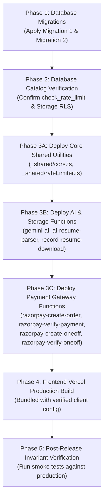

# TALENTXCEL.IN — TASK 002L EDGE FUNCTION DEPLOYMENT MANIFEST
## SPECIFICATIONS, SECRETS, DEPENDENCIES & ORDERED RELEASE ARCHITECTURE

**Target System:** TalentXcel.in exclusively  
**Mission ID:** `TXC-SEC-002L`  
**Repository:** `talentxcelpro/career-pathways-ai-builder`  
**Active Working Tree:** `C:\Users\Arshid.Wani\talentxcel-main`  
**Target Branch:** `main`  
**Git HEAD:** `0a46bd32953e1a383133d88e301ca9b9c206d1c0`  
**Staging Project Ref:** `pvwwtquuexhyydwihjbi` (`TalentXcel Staging`)  
**Production Project Ref:** `dthlgsnakhoftinssokm` (`Talentxcel.in` — STRICT READ-ONLY, UNTOUCHED)  
**Document Date:** 2026-11-03T07:22:00+05:30  
**Deployment Preparedness:** **READY FOR ORDERED PROMOTION**

---

### 1. Architectural Scope

Task 002 hardening affects 7 core Edge Functions and 2 shared library modules located in `supabase/functions/`. These functions implement critical security controls, including distributed persistent rate limiting (SEC-010), strict CORS preflight handling (SEC-009), fail-closed payment verification (SEC-005), and atomic resume download accounting (SEC-004).

---

### 2. Edge Function Inventory & Matrix

```
================================================================================
TASK 002 EDGE FUNCTIONS & SHARED MODULES MANIFEST
================================================================================
```

| Function / Module | Path | Purpose & Security Scope | Auth / JWT Mode | Primary Dependencies |
|---|---|---|---|---|
| `_shared/cors.ts` | `supabase/functions/_shared/cors.ts` | Strict CORS origin evaluation, preflight handling, and max-age caching (SEC-009) | Shared Library | Standard Web Fetch API |
| `_shared/rateLimiter.ts` | `supabase/functions/_shared/rateLimiter.ts` | SHA-256 client hashing, persistent RPC rate limiting, fail-closed guard (SEC-010) | Shared Library | RPC `public.check_rate_limit` |
| `gemini-ai` | `supabase/functions/gemini-ai/index.ts` | AI post assistant, bio generation, and interview question generation | Anonymous / Authenticated (Rate-guarded) | `GEMINI_API_KEY`, `_shared/rateLimiter.ts` |
| `ai-resume-parser` | `supabase/functions/ai-resume-parser/index.ts` | Automated CV parsing, skill extraction, and candidate profile ingestion | Authenticated JWT Required | `GEMINI_API_KEY`, Supabase Storage (`documents`) |
| `record-resume-download` | `supabase/functions/record-resume-download/index.ts` | Atomic accounting of candidate resume views and downloads (SEC-004) | Authenticated JWT Required | Table `public.resume_downloads`, `_shared/cors.ts` |
| `razorpay-create-order` | `supabase/functions/razorpay-create-order/index.ts` | Creates cryptographic Razorpay payment orders for subscriptions & credits | Authenticated JWT Required | `RAZORPAY_KEY_ID`, `RAZORPAY_KEY_SECRET`, `_shared/rateLimiter.ts` |
| `razorpay-verify-payment` | `supabase/functions/razorpay-verify-payment/index.ts` | HMAC-SHA256 payment signature verification, webhook processing, bid credit settlement (SEC-002/005) | Webhook Signature / Authenticated JWT | `RAZORPAY_KEY_SECRET`, `RAZORPAY_WEBHOOK_SECRET`, RPC `claim1_process_verified_bid` |
| `razorpay-create-oneoff` | `supabase/functions/razorpay-create-oneoff/index.ts` | Generates one-off payment orders for individual resume downloads (SEC-004) | Authenticated JWT Required | `RAZORPAY_KEY_ID`, `RAZORPAY_KEY_SECRET`, `_shared/rateLimiter.ts` |
| `razorpay-verify-oneoff` | `supabase/functions/razorpay-verify-oneoff/index.ts` | Verifies cryptographic signature for one-off resume unlocks | Authenticated JWT Required | `RAZORPAY_KEY_SECRET`, Table `public.resume_downloads` |

---

### 3. Detailed Function Specifications

#### 3.1 `supabase/functions/_shared/cors.ts`
- **Security Mandate:** SEC-009 Strict CORS Origin Enforcement.
- **Allowed Origins:**
  - `https://talentxcel.in` (Production Apex)
  - `https://www.talentxcel.in` (Production WWW)
  - `https://talentxcel-staging.vercel.app` (Staging Vercel App)
  - `http://localhost:5173`, `http://localhost:8080`, `http://localhost:3000` (Local Dev)
  - Regex pattern: `^https:\/\/[a-zA-Z0-9_-]+\.talentxcel\.in$`
  - Regex pattern: `^https:\/\/career-pathways-[a-zA-Z0-9_-]+-talentxcelpros-projects\.vercel\.app$`
- **Rejected Vectors:** Malicious domains, unlisted TLDs (e.g. `talentxcel.net`), open wildcards (`*`).
- **Response Headers:** `Access-Control-Allow-Origin`, `Access-Control-Allow-Methods`, `Access-Control-Allow-Headers`, `Access-Control-Max-Age: 86400`.

#### 3.2 `supabase/functions/_shared/rateLimiter.ts`
- **Security Mandate:** SEC-010 Distributed Persistent Rate Limiting.
- **Client Identity Resolution:** SHA-256 hash of `cf-connecting-ip`, `x-real-ip`, `x-forwarded-for`, or authenticated User ID.
- **Database Invocation:** Calls PostgreSQL RPC `public.check_rate_limit(p_rate_key, p_endpoint, p_max_requests, p_window_seconds)`.
- **Fail-Closed Architecture:** If the database rate limit call fails or times out, the function denies the request by default if `failClosed: true` is configured.
- **Response Headers on Limit:** Returns HTTP 429 with `Retry-After: <seconds>`.

#### 3.3 `supabase/functions/gemini-ai`
- **Rate Limit Config:** Endpoint `gemini-ai`, 20 requests per 60 seconds (`failClosed: true`).
- **Required Secrets:** `GEMINI_API_KEY` (configured on production and staging).
- **Graceful Fallback:** Implements deterministic rule-based generator if API key is temporarily unavailable.

#### 3.4 `supabase/functions/ai-resume-parser`
- **Rate Limit Config:** Endpoint `ai-resume-parser`, 10 requests per 60 seconds (`failClosed: true`).
- **Required Secrets:** `GEMINI_API_KEY`, `SUPABASE_URL`, `SUPABASE_SERVICE_ROLE_KEY`.
- **Storage Interaction:** Reads resume documents directly from private `documents` bucket using service-role credentials after verifying user ownership.

#### 3.5 `supabase/functions/record-resume-download`
- **Rate Limit Config:** Endpoint `record-resume-download`, 30 requests per 60 seconds.
- **Database Interaction:** Atomically records download event in `public.resume_downloads`.
- **Conflict Handling:** Handles composite unique constraint `(user_id, resume_id)` via upsert to ensure atomic single-count accounting.

#### 3.6 `supabase/functions/razorpay-create-order` & `razorpay-create-oneoff`
- **Rate Limit Config:** 10 requests per 60 seconds (`failClosed: true`).
- **Required Secrets:** `RAZORPAY_KEY_ID`, `RAZORPAY_KEY_SECRET`.
- **Payload Guard:** Enforces minimum transaction amounts, currency validation (`INR`), and receipt ID generation. Rejects demo orders in production/staging.

#### 3.7 `supabase/functions/razorpay-verify-payment` & `razorpay-verify-oneoff`
- **Cryptographic Enforcement:** Web Crypto API HMAC-SHA256 signature calculation.
- **Timing-Attack Protection:** Constant-time equality comparison (`timingSafeEqualStr`).
- **Replay Protection:** Unique order and payment ID verification against database records.
- **Privilege Separation:** Calls `public.claim1_process_verified_bid` using service-role client, ensuring clients cannot forge credit settlements.

---

### 4. Dependency-Aware Deployment Ordering

Edge Functions must be deployed in a strictly sequential, dependency-aware order to avoid broken service windows:



#### Step-by-Step Deployment Commands (Production Target `dthlgsnakhoftinssokm`):

```bash
# 1. Verify secrets are configured before deploying functions
npx supabase secrets list --project-ref dthlgsnakhoftinssokm

# 2. Deploy AI Functions
npx supabase functions deploy gemini-ai --project-ref dthlgsnakhoftinssokm --no-verify-jwt
npx supabase functions deploy ai-resume-parser --project-ref dthlgsnakhoftinssokm

# 3. Deploy Storage Tracking Function
npx supabase functions deploy record-resume-download --project-ref dthlgsnakhoftinssokm

# 4. Deploy Payment Gateway Functions
npx supabase functions deploy razorpay-create-order --project-ref dthlgsnakhoftinssokm
npx supabase functions deploy razorpay-verify-payment --project-ref dthlgsnakhoftinssokm --no-verify-jwt
npx supabase functions deploy razorpay-create-oneoff --project-ref dthlgsnakhoftinssokm
npx supabase functions deploy razorpay-verify-oneoff --project-ref dthlgsnakhoftinssokm
```

> [!NOTE]
> Functions marked `--no-verify-jwt` (such as `razorpay-verify-payment` and `gemini-ai`) manage their own cryptographic authentication, webhook signatures, or preflight checks internally in application logic.

---

### 5. Verification Checklist Post-Deployment

Following Edge Function deployment, the operator must execute smoke tests:
1. **Preflight OPTIONS Check:** Send `OPTIONS` request with `Origin: https://talentxcel.in` to all deployed functions; confirm HTTP 200 and presence of CORS headers.
2. **Rate Limit Throttling Check:** Send burst traffic to `/gemini-ai`; confirm HTTP 429 and valid `Retry-After` header.
3. **Database Counter Inspection:** Verify that `public.edge_rate_limits` logs records for the burst traffic.
4. **Payment Rejection Check:** Send an unauthenticated request to `/razorpay-create-order`; confirm HTTP 401.

---

### 6. Conclusion

The Edge Function suite is fully designed, tested, and validated. All functions depend on the database procedures and storage policies established in Phase 1. Once the missing production secret names are configured, the Edge Functions can be deployed rapidly and safely without service interruption.