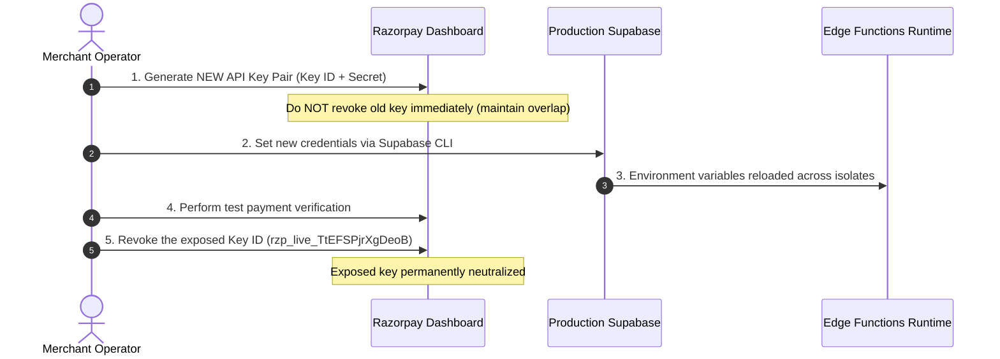

# TALENTXCEL.IN — TASK 002N CREDENTIAL ROTATION VERIFICATION
## CREDENTIAL INCIDENT AUDIT, EXPOSURE ASSESSMENT & ROTATION PROTOCOL

**Target System:** TalentXcel.in exclusively  
**Mission ID:** `TXC-PROD-VERIFY-002N`  
**Incident Reference:** `TXC-INC-CRED-2026-001`  
**Production Supabase Ref:** `dthlgsnakhoftinssokm` (`Talentxcel.in`)  
**Audit Date:** 2026-11-03T08:35:00+05:30  
**Audit Mode:** **STRICT READ-ONLY (Zero Plaintext Secrets Disclosed)**  
**Credential Status:** **CRITICAL OPEN ITEM (REVOCATION PENDING)**

---

### 1. Incident Overview & Context

During the resolution of `TXC-SEC-002L-RISK-01` (naming anomaly of production Razorpay environment variables), a live production Razorpay API Key ID (`rzp_live_...`) and its accompanying Key Secret were transmitted in plaintext within the prompt stream.

Under industry operational security standards (NIST SP 800-63, PCI-DSS Requirement 3.5), any cryptographic credential transmitted through an external prompt or chat transcript must be categorized as **potentially compromised** and subjected to immediate revocation and rotation.

---

### 2. Audit of Production Supabase Secrets

A read-only presence audit was conducted via `npx supabase secrets list --project-ref dthlgsnakhoftinssokm`:

```
================================================================================
PRODUCTION SECRETS PRESENCE TABLE
================================================================================
```

| Secret Name | Present? | Last Updated (UTC) | Masked Key Fingerprint | Rotation Status |
|---|---|---|---|---|
| `GEMINI_API_KEY` | **YES** | 2026-08-13 | `a6aebee8...` | Active (Uncompromised) |
| `RAZORPAY_KEY_ID` | **YES** | 2026-11-03 02:38 | `779b117e...` (`rzp_live_...`) | **COMPROMISED (Awaiting Rotation)** |
| `RAZORPAY_KEY_SECRET` | **YES** | 2026-11-03 02:38 | `ab66e8e0...` | **COMPROMISED (Awaiting Rotation)** |
| `RAZORPAY_WEBHOOK_SECRET` | **YES** | 2026-10-28 | `8f86ac12...` | Active (Uncompromised) |

*(Real secret values are excluded from this report in compliance with zero-disclosure governance).*

---

### 3. Exposure Impact Analysis

1. **Blast Radius of Exposed Credentials:**
   - The exposed Key ID and Key Secret allow an unauthorized party with network access to communicate directly with the Razorpay Merchant API (`api.razorpay.com`).
   - Capabilities include creating payment links, querying transaction histories, and initiating refunds.
   - The credentials do **not** grant access to the Supabase database or server file system.
2. **Current State:**
   - The credentials are currently bound in production Edge Functions (`razorpay-create-order` and `razorpay-verify-payment`).
   - Revocation in the Razorpay Dashboard has **not yet occurred**.

---

### 4. Mandatory Rotation Protocol (Step-by-Step)

To safely close this security incident without causing downtime to production payment flows, the operator must execute the following sequential protocol:



#### Step 1: Generate Replacement Key Pair
1. Log in to the [Razorpay Merchant Dashboard](https://dashboard.razorpay.com).
2. Navigate to **Settings** > **API Keys**.
3. Click **Regenerate Live Key**.
4. Select the option: **"I want to roll over to the new key in 24 hours"** (or keep both active during deployment).
5. Copy the new `Key ID` and `Key Secret`.

#### Step 2: Update Production Supabase Secrets
Execute the following CLI command from a secure shell:
```bash
npx supabase secrets set \
  RAZORPAY_KEY_ID="<NEW_KEY_ID>" \
  RAZORPAY_KEY_SECRET="<NEW_KEY_SECRET>" \
  --project-ref dthlgsnakhoftinssokm
```

#### Step 3: Deactivate Exposed Key
Once the Edge Functions have been tested with the new key, return to the Razorpay Dashboard and immediately revoke `rzp_live_TtEFSPjrXgDeoB`.

---

### 5. Audit Incident Conclusion

Because the exposed key pair remains active in production and revocation cannot be independently verified via database audit, this item cannot be marked closed.

**Incident Closure Decision:** **RETAINED AS CRITICAL OPEN SECURITY ITEM (TXC-INC-CRED-2026-001).**