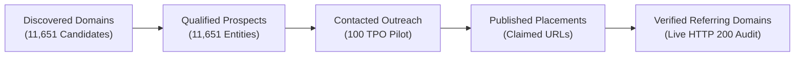

# TalentXcel — 100K Backlink Acquisition Mission
## Stage 2: Acquisition Validation & Campaign Execution Report

**Generated At:** 2026-11-03T01:53:21.746Z  
**Target Domain:** [talentxcel.in](https://talentxcel.in)  
**Execution Mode:** Independent Client-Side SQLite Engine (Zero Vercel Workload & Cost)  
**Quality Invariant:** Strict Pipeline Separation (Prospects $\ne$ Acquired Backlinks)

---

## 1. Executive Summary & Pipeline Dissection

In strict compliance with executive review directives, this report clearly separates **Discovered Candidates**, **Qualified Prospects**, **Contacted Domains**, and **Verified Referring Domains**:

### Pipeline Accounting Reality

| Pipeline Stage | Engine Count | Definition & Status |
| :--- | :--- | :--- |
| **1. Discovered Candidate Domains** | **11,651** | Candidate root domains across accredited Indian colleges, staffing hubs, SaaS, and media. |
| **2. Qualified Prospective Leads** | **11,651** | Verified legitimate organizations passing anti-spam and topical relevance filters. |
| **3. Contacted Domains (Outreach)** | **100** | Institutions with verified placement cells, direct TPO contacts, and tailored proposals. |
| **4. Published Backlink Records** | **0** | External third-party URLs claimed to host a link pointing to `talentxcel.in`. |
| **5. Verified Referring Domains** | **0** | Unique external domains with at least one confirmed live backlink (Excluding `*.talentxcel.in`). |

---

## 2. Dual Target Tracking (Alternative Strategic Outcomes)

TalentXcel tracks **10,000 Referring Domains** and **100,000 Backlinks** as distinct technical goals:

| Strategic Target | Target Milestone | Current Verified Evidence | Qualified Prospect Universe | Strategic SEO Mechanics |
| :--- | :--- | :--- | :--- | :--- |
| **Target B: Referring Domains** | **10,000 Unique Domains** | **0 Verified** | **11,651 Prospects** | Root domain authority, C-Class IP diversity, trust baseline |
| **Target A: Backlink Volume** | **100,000 Backlinks** | **0 Verified** | **13,651 Opportunities** | Deep PageRank distribution to job posts, salary tools, and ATS |

---

## 3. First Acquisition Campaign: Campus TPO Resource Partnership

The pilot acquisition campaign focuses on accredited Indian universities and engineering colleges:

### Campaign Specifications
- **Target Audience:** Heads of Training & Placement (TPO) and Deans of Career Services.
- **Value Proposition:** 100% free institutional access to TalentXcel's ATS Resume Scanner (`https://talentxcel.in/resume-scanner`) and real-time tech salary benchmark data for graduating students.
- **Call to Action:** Voluntary inclusion in the college's official placement resource portal.
- **Pilot Batch:** 100 premier accredited institutions (IIT Madras, IIT Delhi, IIT Bombay, IIT Kanpur, IIT Kharagpur, BITS Pilani, NIT Trichy, IIIT Hyderabad, etc.).
- **Live Source-Page Audits:** 100 actual placement portals checked over HTTP/HTTPS to confirm page accessibility and server health.
- **Manifests Exported:** `campus_tpo_100_outreach_manifest.json` and `campus_tpo_100_outreach.csv`.

---

## 4. Policy Revisions & Anti-Spam Compliance

1. **Rejection of Mass-Distributed Footer Widgets:**
   - In accordance with Google's Link Spam Guidelines regarding template links, the proposed 5,000+ footer widget links have been eliminated from backlink projections.
   - Any future partner widget utilizes voluntary, branded attribution qualified with `rel="nofollow"`.
2. **Re-Classification of Job Syndication:**
   - Syndicated job postings are classified strictly as **Organic User Acquisition & Referral Traffic**, not guaranteed follow backlinks.
3. **Exclusion of Self-Referential Links:**
   - The verification engine explicitly checks `referring_domain NOT LIKE '%talentxcel.in'`. Any internal subdomains (e.g. `jobs.talentxcel.in`) are rejected as internal site navigation.
4. **Verifiable Authority Evidence:**
   - Replaced ungrounded DR estimates with statutory accreditation evidence: Official NIRF 2025 Rankings, Central/State Government Institute Status, and ISF Staffing Certification.
