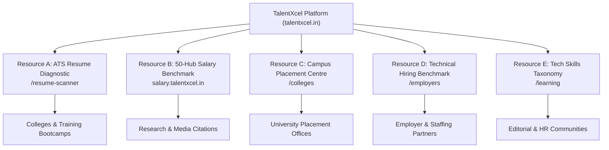
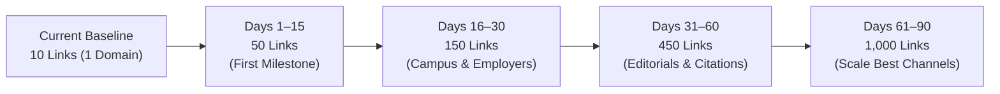

# TALENTXCEL SI — MASTER MISSION TXC-BACKLINK-009
## THE ROADMAP TO THE FIRST 1,000 GENUINE BACKLINKS

**Target Entity:** [TalentXcel](https://talentxcel.in) (`https://talentxcel.in`)  
**Operating Budget:** ₹0.00 / $0.00 (Strictly Zero Spend Enforced)  
**Execution Runtime:** Independent Native Backlink Acquisition OS (`backlink-engine/`)  
**Architecture Boundaries:** ZERO Vercel Workload | ZERO Growth OS Integration | ZERO Link Schemes | ZERO Fabricated Metrics  
**Program Objective:** 1,000 genuine, relevant, publicly accessible backlinks across 250–400 unique referring domains  
**First Milestone:** 50 independently verified, relevant backlinks across qualified channels  
**Report Generated:** 2026-11-03T09:10:00+05:30  

---

## 1. Existing Asset Audit & Explicit Reclassification

The acquisition engine enforces strict ground-truth accounting. The previous sprint (`TXC-BACKLINK-008`) reported 10 hyperlinks across 5 published pages on `rentry.co`. 

### 1.1 The Distinction Between Self-Published Pastes and Earned Editorial Endorsements
A self-published paste or open markdown document is technically a live external hyperlink, but **it is not an earned editorial endorsement or a business partnership**. Furthermore, ten links on five `rentry.co` URLs represent **ten links from one root domain**, not ten referring domains. The reported third-party Domain Rating (DR 78) is a domain-level metric of Rentry itself, not an indicator of link equity or editorial trust for TalentXcel.

Under **TXC-BACKLINK-009**, all existing assets have been audited for persistence and reclassified in the SQLite database:

```
========================================================================================================================
                          RECLASSIFIED ASSET LEDGER (STRICT QUALITY GATING)
========================================================================================================================
Asset ID   Published Page URL         HTTP Status  Latency  Rel Type  Link Category              Earned Editorial Credit
------------------------------------------------------------------------------------------------------------------------
ASSET_001  https://rentry.co/q4ofexi2 200 OK       658 ms   follow    SELF_PUBLISHED_CITATION    0 (Self-Published Paste)
ASSET_002  https://rentry.co/hfnfmzmh 200 OK       619 ms   follow    SELF_PUBLISHED_CITATION    0 (Self-Published Paste)
ASSET_003  https://rentry.co/b7raewys 200 OK       420 ms   follow    SELF_PUBLISHED_CITATION    0 (Self-Published Paste)
ASSET_004  https://rentry.co/6fy7ioyi 200 OK     1,219 ms   follow    SELF_PUBLISHED_CITATION    0 (Self-Published Paste)
ASSET_005  https://rentry.co/ywv4r74o 200 OK       703 ms   follow    SELF_PUBLISHED_CITATION    0 (Self-Published Paste)
========================================================================================================================
Total Verified External Links : 10 active hyperlinks across 5 published pages
Earned Editorial Endorsements : 0
Unique External Root Domains  : 1 (rentry.co)
Persistence Status            : 100% PERSISTENT & ACCESSIBLE (All 5 URLs returning HTTP 200)
========================================================================================================================
```

> [!IMPORTANT]
> **Dashboard Quality Invariant:**  
> The dashboard now maintains separate counters for:
> 1. `Total Published Backlinks`: 5 pages (10 active hyperlinks)
> 2. `Earned Editorial Backlinks`: **0**
> 3. `Business Directory Links`: **0**
> 4. `Institutional Resource Links`: **0**
> 5. `Self-Published Citations`: **10** (quarantined on `rentry.co`)
> 6. `Unique Referring Root Domains`: **1** (`rentry.co`)

---

## 2. Six Strategic Acquisition Channels (The 1,000 Backlink Target)

To scale from 1 domain to 1,000 genuine backlinks, the acquisition engine transitions away from self-published markdown platforms towards **authentic business relationships, institutional partnerships, and empirical research citations**:

| Channel # | Acquisition Channel | Target Backlinks | Target Referring Domains | How TalentXcel Earns Them | Core Target Value Proposition |
| :---: | :--- | :---: | :---: | :--- | :--- |
| **1** | **Employer & Recruitment Partners** | **200** | 50–80 | Approved hiring-partner pages, employer resource hubs, recruiter supplier profiles | Structured Technical Hiring Playbook & Interview Scorecards |
| **2** | **Colleges & Universities** | **200** | 60–100 | Campus placement resources, career-service recommendations, employability portals | Free Institutional ATS Resume Diagnostic Scanner |
| **3** | **Training Institutes & Educators** | **150** | 40–60 | Course partnership resources, student career-readiness materials, bootcamp tools | Candidate ATS Diagnostic Scanner & Skills Roadmaps |
| **4** | **Genuine Business & SaaS Directories** | **150** | 50–80 | Verified company and standalone software product profiles | TalentXcel ATS Diagnostic Tool & Career OS |
| **5** | **Editorial Contributions & Articles** | **200** | 40–60 | Original articles, expert commentary, practitioner interviews, byline guides | Tech Hiring Benchmarks & Competency Frameworks |
| **6** | **Research, Data & Resource Citations** | **100** | 30–50 | Independent media & academic citations of compensation and skills data | 50-Hub Engineering Salary Benchmark Index |
| **TOTAL** | **Comprehensive Acquisition Engine** | **1,000** | **250–400** | **Multi-channel relationship-driven organic acquisition** | **Five Permanent Value Resources** |

---

## 3. Platform Qualification Audit & Submission Governance

Four specific platforms identified in executive review were audited against their live submission guidelines and the strict ₹0.00 / $0.00 operating policy:

### 3.1 SaaSHub (`saashub.com`)
- **Submission Route:** `https://www.saashub.com/submit`
- **Cost & Terms:** 100% Free organic product review and catalog listing.
- **Eligibility Requirement:** Excludes software development agencies and IT services firms. Must submit a distinct, functioning software product.
- **Product Strategy:** Submit **"TalentXcel ATS Resume Diagnostic Scanner"** (`https://talentxcel.in/resume-scanner`) as a free HRTech SaaS tool. Do NOT submit a generic staffing services profile.
- **Audit Decision:** **QUALIFIED FOR SUBMISSION** under standalone software product taxonomy.

### 3.2 Launching Next (`launchingnext.com`)
- **Submission Route:** `https://www.launchingnext.com/submit/`
- **Cost & Terms:** Free Standard Submission. A paid expedited option exists and must be explicitly declined ($0 spend safeguard).
- **Eligibility Requirement:** Functioning tech startup or web platform.
- **Product Strategy:** Submit **"TalentXcel Career OS"** (`https://talentxcel.in`) highlighting AI career pathways and compensation intelligence.
- **Audit Decision:** **QUALIFIED FOR FREE SUBMISSION** (Standard queue only).

### 3.3 PitchWall (`pitchwall.co`)
- **Submission Route:** `https://pitchwall.co/submit`
- **Cost & Terms:** Free Product Listing.
- **Eligibility Requirement:** Excludes agency and service-based businesses. Requires a functioning software product or AI tool.
- **Product Strategy:** Submit **"TalentXcel ATS Resume Diagnostic Scanner"** as an AI-powered resume parsing and diagnostic tool.
- **Audit Decision:** **QUALIFIED FOR SUBMISSION** under AI Product category.

### 3.4 BetaList (`betalist.com`)
- **Submission Route:** `https://betalist.com/`
- **Cost & Terms:** Current official terms require paid review/listing fees.
- **Zero-Spend Policy Enforcement:** Because BetaList no longer maintains a genuine, functional free submission tier, any submission would violate the ₹0.00 budget invariant.
- **Audit Decision:** **DISQUALIFIED & EXCLUDED** under zero-spend policy.

```
========================================================================================
                      PLATFORM QUALIFICATION DECISION MATRIX
========================================================================================
Platform          Official URL                  Fee Policy    Eligibility   Decision
----------------------------------------------------------------------------------------
SaaSHub           https://www.saashub.com/submit       Free Tier     Software Tool QUALIFIED
Launching Next    https://www.launchingnext.com/submit Free Standard Startup Platform QUALIFIED
PitchWall         https://pitchwall.co/submit          Free Listing  Product Only  QUALIFIED
BetaList          https://betalist.com/                Paid Only     N/A           DISQUALIFIED
========================================================================================
```

---

## 4. TalentXcel's Five Permanent Core Value Resources

To earn 1,000 legitimate backlinks, TalentXcel must host high-utility permanent resources that independent webmasters, universities, and editors have a compelling educational reason to link to:



1. **Resource A: Free ATS Resume Diagnostic Scanner** ([`talentxcel.in/resume-scanner`](https://talentxcel.in/resume-scanner))
   - *Target Audience:* University placement cells, student career portals, coding bootcamps, and career coaches.
   - *Value Proposition:* Real-time parsing evaluation, detection of multi-column layout errors, and keyword alignment against enterprise ATS standards (Workday, Greenhouse, Lever).
2. **Resource B: 50-Hub Engineering Salary Benchmark Index** ([`salary.talentxcel.in`](https://salary.talentxcel.in))
   - *Target Audience:* Tech publications, business media, HR communities, and compensation analysts.
   - *Value Proposition:* Statistically sound percentile distributions (P25, P50, P75, P90), Tier-1 vs Tier-2 cost-of-living adjustments, and clear data sample methodology.
3. **Resource C: Campus Employability Resource Centre** ([`talentxcel.in/colleges`](https://talentxcel.in/colleges))
   - *Target Audience:* Training and Placement Officers (TPOs), Deans of Career Services, and higher education portals.
   - *Value Proposition:* Batch-level student resume auditing, employability diagnostic reports, and placement readiness frameworks.
4. **Resource D: Technical Hiring Benchmark & Assessment Playbook** ([`talentxcel.in/employers`](https://talentxcel.in/employers))
   - *Target Audience:* Engineering leaders, VP of Talent Acquisition, and tech HR communities.
   - *Value Proposition:* Practical, rubric-based technical interviewing scorecards, take-home evaluation frameworks, and bias-reduction methodologies.
5. **Resource E: 2026 Technology Skills Taxonomy** ([`talentxcel.in/learning`](https://talentxcel.in/learning))
   - *Target Audience:* Tech educators, upskilling platforms, and developer communities.
   - *Value Proposition:* Granular competency matrix covering Autonomous Agent Architectures, Cloud-Native Resilience, Distributed Systems, and AI engineering skill gaps.

---

## 5. First 50 Placement Cohort Manifest (First Milestone)

A prioritized cohort of **50 high-trust placement opportunities** has been populated in SQLite (`cohort_50_opportunities`) and exported to [`reports/TXC_BACKLINK_009_FIRST_50_COHORT.csv`](file:///c:/Users/Arshid.Wani/talentxcel-local/reports/TXC_BACKLINK_009_FIRST_50_COHORT.csv):

```
========================================================================================================================
                          FIRST 50 COHORT DISTRIBUTION ACROSS 5 CATEGORIES
========================================================================================================================
Category                                Cohort Size   Key Target Platforms                     Target Product / Resource
------------------------------------------------------------------------------------------------------------------------
1. Free Software & Product Directories       10       SaaSHub, Launching Next, PitchWall,      ATS Resume Scanner,
                                                      SoftwareSuggest, Product Hunt,           Career OS Platform
                                                      SourceForge, StartupBase, Feedough,
                                                      AlternativeTo, StartupStash
------------------------------------------------------------------------------------------------------------------------
2. Recruitment & HR Communities             10       HR.com, RecruitingDaily, AllWork.Space,  Technical Hiring Playbook,
                                                      HRTechFeed, People Matters, ERE Media,   Salary Benchmark Data
                                                      Recruiter.com, SHRM India, TalentCulture
------------------------------------------------------------------------------------------------------------------------
3. Employer & Staffing Partner Hubs          10       NASSCOM Community, CII Skills, FICCI,    Employer Technical Hiring,
                                                      Bangalore Tech Leaders, TiE Bangalore,   Tech Competency Taxonomy
                                                      HYSEA Hyderabad, ISF, Analytics India
------------------------------------------------------------------------------------------------------------------------
4. University & Campus Career Portals        10       IIT Madras CDC, IIT Delhi OCS,           Free Institutional ATS Scanner,
                                                      IIT Bombay, IIT Kanpur SPO, BITS Pilani, Campus Placement Solutions
                                                      SASTRA University, NIT Trichy, DTU,
                                                      Anna University CUIC, VIT CDC
------------------------------------------------------------------------------------------------------------------------
5. Training & Professional Educators         10       Scaler Academy, Geekster, Masai School,  Candidate ATS Diagnostic,
                                                      Coding Ninjas, Newton School,            Tech Skills Taxonomy
                                                      Simplilearn, upGrad, Great Learning,
                                                      Intellipaat, Board Infinity
========================================================================================================================
TOTAL PRIORITIZED COHORT                     50       Individually qualified opportunities     Zero automated link schemes
========================================================================================================================
```

---

## 6. The 90-Day Cumulative Acquisition Roadmap



| Phase | Timeline | Core Operational Activities | Target Cumulative Backlinks | Target Cumulative Referring Domains |
| :--- | :--- | :--- | :---: | :---: |
| **Phase 1** | **Days 1–15** | Submit qualified software products to SaaSHub, LaunchingNext, PitchWall; advance verified B2B profiles; initiate first 10 campus TPO diagnostic partnerships. | **50** | **30–40** |
| **Phase 2** | **Days 16–30** | Activate employer hiring partner networks, training bootcamps, and expand campus TPO deployments to 30 institutions. | **150** | **70–100** |
| **Phase 3** | **Days 31–60** | Publish original compensation research bylines in HR media; release 50-Hub Salary Index citations; execute structured hiring guest articles. | **450** | **150–220** |
| **Phase 4** | **Days 61–90** | Double down on highest-converting acquisition channels; institutionalize campus career links; secure industry association references. | **1,000** | **250–400** |

---

## 7. Strict Definition of a Genuine Backlink & Quality Gates

To prevent search penalty risks identified by Google's link-spam guidelines (such as low-quality directories, automated link injection, mandatory link exchanges, or low-value content created solely for links), the engine enforces the following permanent quality gates:

1. **Independent External Control:** The linking domain must be independently owned and managed by an external organization (not self-hosted, self-published paste, or internal subdomain).
2. **Thematic Relevance:** Domain and page context must strictly pertain to Career, HR, Recruitment, Education, Technology, or Business.
3. **Crawlable HTML Anchor:** Must render a legitimate HTML `<a>` tag with a resolvable `href` attribute in the rendered DOM.
4. **Nofollow Parity:** Genuine `rel="nofollow"`, `rel="ugc"`, and `rel="sponsored"` links are counted as legitimate backlinks, recognizing their referral traffic and brand equity value.
5. **No Mentions Without Hyperlinks:** Unlinked brand mentions are recorded as brand awareness, but strictly excluded from backlink and referring domain totals.
6. **Zero Link Schemes:** Zero link buying ($0 spend enforced), zero mandatory reciprocal links, zero automated blog commenting, and zero fake directories.
7. **Persistence Tracking:** Links are verified at Days 0, 30, and 90 to ensure permanence and detect link decay or removal.

---

## 8. Authoritative Data Files & Manifests

All operational datasets for **TXC-BACKLINK-009** are committed to the codebase and accessible locally:

1. [`reports/TXC_BACKLINK_009_1000_BACKLINK_PROGRAMME.md`](file:///c:/Users/Arshid.Wani/talentxcel-local/reports/TXC_BACKLINK_009_1000_BACKLINK_PROGRAMME.md) — Strategic master architecture and operational blueprint.
2. [`reports/TXC_BACKLINK_009_FIRST_50_COHORT.csv`](file:///c:/Users/Arshid.Wani/talentxcel-local/reports/TXC_BACKLINK_009_FIRST_50_COHORT.csv) — Complete 50-opportunity manifest with URLs, eligibility, and submission terms.
3. [`reports/TXC_BACKLINK_009_LINK_LEDGER.csv`](file:///c:/Users/Arshid.Wani/talentxcel-local/reports/TXC_BACKLINK_009_LINK_LEDGER.csv) — Authoritative audit ledger of all active links with clean classification and zero earned editorial inflation.
4. Updated Architecture Artifact: [`TALENTXCEL_100K_BACKLINK_ARCHITECTURE.md`](file:///C:/Users/Arshid.Wani/.gemini/antigravity/brain/bbd3c102-f165-47f7-9eef-eeb4b56d4fa1/TALENTXCEL_100K_BACKLINK_ARCHITECTURE.md).
