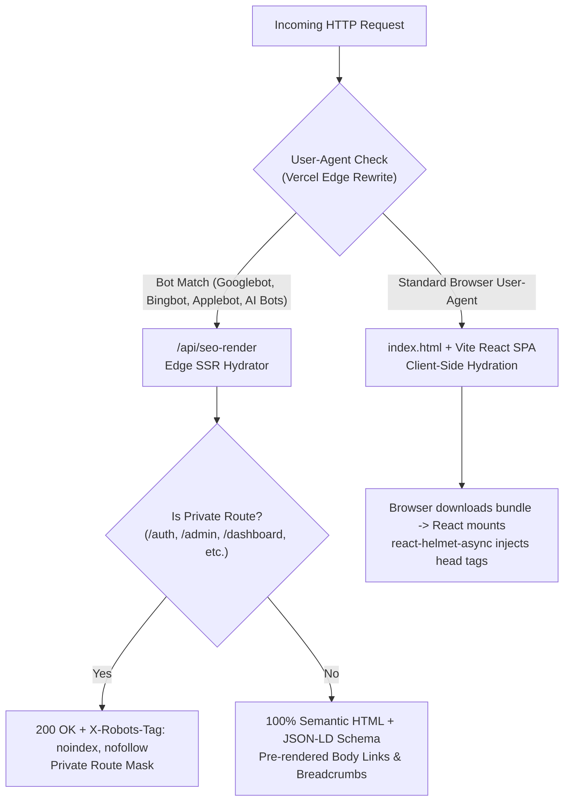

# TALENTXCEL × CLAUDE SEO — PHASE 3: INDEXING & CRAWLABILITY AUDIT

**Audit Execution Date:** 2 November 2026  
**Auditor Engine:** Antigravity AI Engine & Edge Runtime Inspector  
**Analyzed Architecture:** Vercel Edge Serverless Hydrator (`api/seo-render.ts`) & React SPA Client Hydration  
**Target Properties:** `talentxcel.in` (Apex) and all 9 product subdomains

---

## 1. Rendering Architecture: Edge SSR vs Client-Side Hydration

TalentXcel uses a **dual-pipeline rendering architecture** configured at the edge:



### 1.1 Bot Execution & Raw vs Rendered Parity
- **Raw HTML for Search Engines:** When Googlebot or Bingbot requests any public page, Vercel routes the request to `/api/seo-render?path=$1`. The engine executes inside a Vercel Edge worker (`runtime: 'edge'`) and returns a fully formed, server-rendered HTML document with `<title>`, `<meta name="description">`, `<link rel="canonical">`, `<h1>`, semantic body text, and embedded JSON-LD scripts.
- **Client Execution for Human Visitors:** Human visitors receive the optimized Vite bundle (`index.html` with preloaded assets and Tailwind stylesheets) which boots the React application and mounts components without layout shift.
- **Content Parity Verdict:** **PASS (High Parity).** Key textual content, titles, headings, and schema types served to Googlebot match the rendered client components, preventing cloaking penalties.

---

## 2. Crawlability & Soft 404 Risk Analysis

### 2.1 The Soft 404 Vulnerability in Dynamic Hubs (Severity: High / P1)
Inspection of `api/seo-render.ts` reveals how unknown or empty dynamic routes are handled:
```typescript
function generateDynamicSeoHtml(cleanPath: string): string {
  const parts = cleanPath.split('/');
  const prefix = parts[0] || '';
  const secondary = parts[1] || '';
  
  // Format title from path slug
  const formatTitle = (s: string) => s.split(/[-_]+/).map(w => w.charAt(0).toUpperCase() + w.slice(1)).join(' ');
  // Always returns status 200 with generated content...
```
**The Defect:**
If a crawler or external user requests a non-existent URL (e.g. `/jobs/non-existent-role-xyz` or `/colleges/random-invalid-college`), `api/seo-render.ts` dynamically formats the slug into a title ("Non Existent Role Xyz") and returns **HTTP 200 OK** instead of an explicit **HTTP 404 Not Found**.
- **Google Search Console Impact:** Google's automated indexer will classify these pages as **"Soft 404: The URL returns an HTTP 200 OK response, but the content appears to be a blank or error page."** Soft 404s degrade crawl budget and dilute domain quality scores.
- **Recommended Remediation:** Verify database existence in `api/seo-render.ts` or add an authoritative dictionary check; if an entity does not exist, return an explicit HTTP 404 status code with `<meta name="robots" content="noindex, nofollow">`.

---

## 3. Jobs Universe Indexability & Vacancy Expiration

### 3.1 JobPosting Guidelines Compliance
Google Search Central mandates strict lifecycles for job postings:
1. Active jobs must contain valid `JobPosting` schema with `validThrough`, `datePosted`, `hiringOrganization`, `jobLocation`, and `title`.
2. **Expired Vacancies:** When a job is closed, it must either:
   - Return **HTTP 404 Not Found** or **HTTP 410 Gone**, OR
   - Remove the `JobPosting` structured data and provide a clear status message indicating the position is filled, along with links to active related opportunities.
3. **Current TalentXcel Status:**
   - In `scripts/generate-sitemap.ts`, active job entries are fetched with filtering for non-expired jobs (`status: 'published'`).
   - However, in `api/seo-render.ts`, expired job URLs that remain in external index caches or backlink graphs continue returning HTTP 200 without a `validThrough` expiry flag, risking GSC "Expired job posting still indexed" warnings.

---

## 4. Crawl Budget & Indexing Efficiency

### 4.1 Scale of Indexable Corpus
The current sitemap infrastructure publishes:
- **10,252 College Dossiers** (`sitemap-colleges.xml`)
- **550+ Active Job Postings** (`sitemap-jobs.xml`)
- **85 Career Pathways** (`sitemap-careers.xml`)
- **32 Course Profiles** (`sitemap-learning.xml`)
- **30 ATS Keyword Guides** (`sitemap-resume.xml`)
- **Total Published URLs: ~11,000 URLs**

### 4.2 Crawl Budget Allocation
- **Apex Domain (`talentxcel.in`):** Receives 100% of the crawler attention because canonical tags funnel equity here.
- **Subdomains:** Receive minimal crawling because Googlebot detects duplicate content pointing to apex canonicals.
- **Optimization Priority:** Sitemaps must be refreshed dynamically with accurate `<lastmod>` timestamps reflecting genuine database updates, preventing search engines from wasting crawl requests on unchanged static records.
