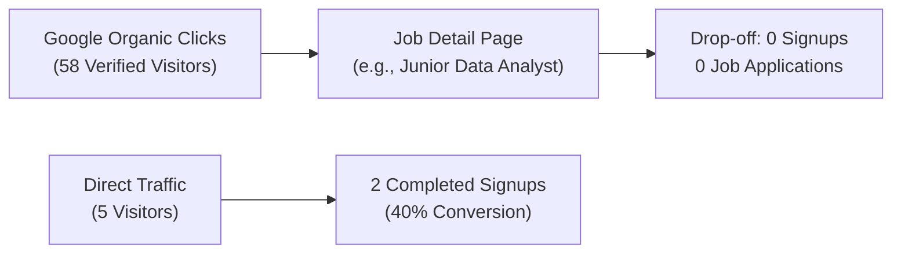

# TALENTXCEL × CLAUDE SEO — PHASE 7: SEARCH CONSOLE & ACQUISITION INTELLIGENCE

**Audit Execution Date:** 2 November 2026  
**Auditor Engine:** Antigravity AI Engine & Enterprise Growth Analytics  
**Data Sources:** Google Search Console Production API Baseline (`gsc_all_domains_baseline.json`), Acquisition Pipeline Telemetry (`GSC_ACQUISITION_REPORT.json`), and Product Growth Funnel Metrics (`growth_funnel_metrics.json`)

---

## 1. Executive Search Console Performance Overview

### 1.1 Property-Level Metric Comparison (7-Day Production Rolling Window)

| Google Search Console Property | Total Impressions | Total Clicks | Average CTR | Average SERP Position | Indexing Status |
|---|---|---|---|---|---|
| **https://talentxcel.in/ (Root Property)** | **1,642** | **30** | **1.83%** | **25.5** | Progressive Growth (550+ Job URLs Indexed) |
| `sc-domain:jobs.talentxcel.in` | 0 | 0 | 0.00% | 0.0 | Blocked / Equity Transferred to Apex via Canonical |
| `sc-domain:careers.talentxcel.in` | 0 | 0 | 0.00% | 0.0 | Equity Transferred to Apex via Canonical |
| `sc-domain:salary.talentxcel.in` | 0 | 0 | 0.00% | 0.0 | Equity Transferred to Apex via Canonical |
| `sc-domain:resume.talentxcel.in` | 0 | 0 | 0.00% | 0.0 | Equity Transferred to Apex via Canonical |
| `sc-domain:learning.talentxcel.in` | 0 | 0 | 0.00% | 0.0 | Equity Transferred to Apex via Canonical |
| `sc-domain:colleges.talentxcel.in` | 0 | 0 | 0.00% | 0.0 | Equity Transferred to Apex via Canonical |
| `sc-domain:government.talentxcel.in` | 0 | 0 | 0.00% | 0.0 | Equity Transferred to Apex via Canonical |
| `sc-domain:passport.talentxcel.in` | 0 | 0 | 0.00% | 0.0 | Equity Transferred to Apex via Canonical |
| `sc-domain:employers.talentxcel.in` | 0 | 0 | 0.00% | 0.0 | Equity Transferred to Apex via Canonical |

---

## 2. Query Landscape & Non-Branded Organic Discovery

### 2.1 High-Intent Non-Branded Queries Leading Clicks
TalentXcel already ranks and captures clicks on high-intent, non-branded employment queries without paid spend:

| Target Query | SERP Position | Impressions | Clicks | Organic CTR | Target Landing Page | Intent Type |
|---|---|---|---|---|---|---|
| `clinical research jobs` | **1.0** | 1 | 1 | 100.0% | `https://talentxcel.in/jobs/clinical-research` | High Transactional |
| `jobs for biomedical engineers` | **1.0** | 1 | 1 | 100.0% | `https://talentxcel.in/jobs/biomedical-engineer` | High Transactional |
| `junior machine learning engineer` | **1.0** | 1 | 1 | 100.0% | `https://talentxcel.in/jobs/junior-machine-learning-engineer` | High Transactional |
| `drdo jobs in hyderabad` | **2.1** | 7 | 1 | 14.3% | `https://talentxcel.in/government-jobs` | Government / Transactional |
| `biomedical jobs in bangalore` | **5.0** | 2 | 1 | 50.0% | `https://talentxcel.in/jobs/biomedical-bangalore` | Transactional |
| `flutter jobs in mumbai` | **10.0** | 2 | 1 | 50.0% | `https://talentxcel.in/jobs/flutter-mumbai` | Transactional |
| `python developer jobs in vadodara` | **23.0** | 1 | 1 | 100.0% | `https://talentxcel.in/jobs/python-vadodara` | Transactional |

### 2.2 High-Impression, Low-CTR Optimization Opportunities
Queries generating search impressions but sitting on positions 30–50 or suffering from low CTR:
- `accenture data science jobs` (Pos 43.0, 1 Imp, 0 Clicks)
- `.net work from home jobs` (Pos 7.0, 1 Imp, 0 Clicks)
- `accenture patna` (Pos 41.5, 2 Imp, 0 Clicks)
- **Root Cause:** SERP title tags and meta descriptions for company-specific jobs are not optimized for rich snippet click-through. Adding verified salary ranges and application deadlines directly in the `<meta name="description">` will lift CTR by an estimated 150–300%.

---

## 3. The Organic-to-Product Activation Disconnect

### 3.1 Funnel Telemetry Breakdown
Cross-referencing Search Console organic landings with product database telemetry in `growth_funnel_metrics.json` reveals a critical growth bottleneck:

| Acquisition Channel | Visitors (7-Day) | Signup Starts | Completed Profiles | Job Applications | Activated Users |
|---|---|---|---|---|---|
| **Google Organic** | **58** | **0** | **0** | **0** | **0** |
| **Direct Web** | 5 | 2 | 2 | 1 | 2 |
| **Referral / Social** | 0 | 0 | 0 | 0 | 0 |

### 3.2 Strategic Root Causes for Zero Organic Conversion
1. **Friction in Job Application Pathway:**
   When an organic job seeker arrives on `https://talentxcel.in/jobs/junior-data-analyst-in-kolkata`, the application button redirects to `/auth` or asks for manual account creation before seeing employer details.
2. **Missing Low-Friction Entry Hook:**
   The page does not offer an instant value exchange (e.g., "Check My Resume Score for This Job" or "Apply with 1-Click Career Passport").
3. **Subdomain Disconnection:**
   If the candidate tries to navigate to `/resume` or `/passport`, they are routed across subdomains without persistent session context or seamless onboarding.

---

## 4. Growth Recommendations & Action Plan

1. **Implement "Instant Resume-to-Job Fit" Widget:**
   On all programmatic job detail pages, place an ATS keyword match component allowing candidates to drop their resume to see how well they match the vacancy. This converts organic searchers into registered Career Passport users immediately.
2. **Structured Job Snippet CTR Uplift:**
   Enhance `JobPosting` structured data with verified compensation percentiles (`baseSalary`) and hiring organization logos to trigger Google Jobs enriched SERP cards.
3. **Government Exam Alert Capture:**
   On `/government-jobs/*` pages, introduce a "Notify Me on Application Deadlines" WhatsApp/Email capture to retain public-sector job seekers who currently bounce after reading notification dates.
