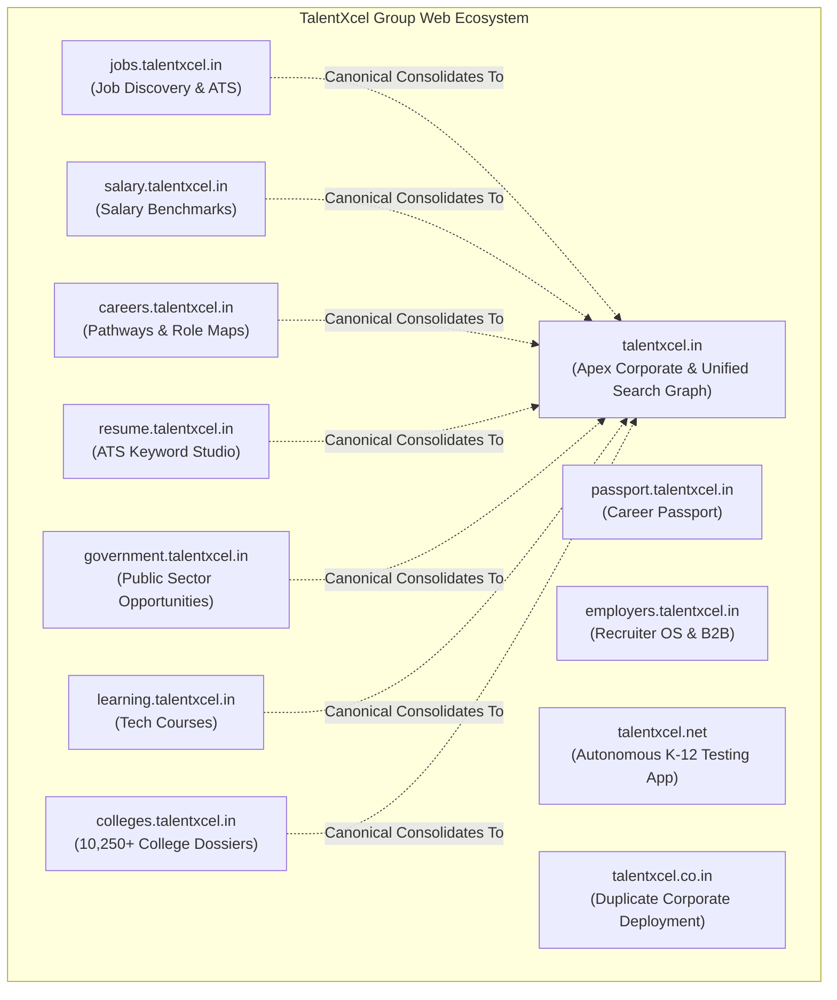

# TALENTXCEL × CLAUDE SEO — PHASE 9: CROSS-DOMAIN ARCHITECTURE & CANNIBALIZATION ANALYSIS

**Audit Execution Date:** 2 November 2026  
**Auditor Engine:** Antigravity AI Engine & Multi-Domain System Architect  
**Properties Audited:** `talentxcel.in` (Apex + 9 Subdomains), `talentxcel.net`, `talentxcel.co.in`  
**Core Question:** Should TalentXcel consolidate search equity onto the apex domain, or should product subdomains operate as independent search entities?

---

## 1. Domain Ecosystem Topology

---

## 2. In-Depth Multi-Domain Evaluation

### 2.1 The Apex Consolidation Model (Current Implementation)
The repository enforces an **Apex Authority Consolidation model** (`src/config/domainArchitecture.ts` lines 427–432):
- **Mechanism:** When a visitor or crawler lands on `https://jobs.talentxcel.in/jobs/senior-devops-engineer`, the HTML contains:
  `<link rel="canonical" href="https://talentxcel.in/jobs/senior-devops-engineer" />`
- **Strategic Advantages:**
  1. Prevents split PageRank and backlinks. All external links pointing to either `jobs.` or `talentxcel.in` strengthen a single domain's authority score.
  2. Simplifies GSC monitoring by concentrating impressions and rankings under `https://talentxcel.in/`.
- **Strategic Drawbacks:**
  1. Completely eliminates search visibility for subdomain properties: `jobs.talentxcel.in` and `salary.talentxcel.in` have **0 recorded GSC impressions and 0 clicks**.
  2. Brand SERP presence is limited to one root domain rather than dominating search results across dedicated sub-brands.
  3. Violates Google's sitemap origin requirement when subdomain sitemaps list apex URLs.

### 2.2 Independent Subdomain Indexing (Alternative Architecture)
In this model (used by sites like Amazon, Glassdoor, and Google products):
- `jobs.talentxcel.in/jobs/*` self-canonicalizes to `https://jobs.talentxcel.in/jobs/*`.
- `salary.talentxcel.in/salary/*` self-canonicalizes to `https://salary.talentxcel.in/salary/*`.
- **Pros:** Subdomains can build independent specialized topical authority in their vertical (e.g., jobs search, salary intelligence).
- **Cons:** Dilutes backlinks across 10 domains; requires distinct domain authority cultivation for each subdomain.
- **Audit Decision:** In accordance with Non-Negotiable Rule 2.1 ("Do not modify existing canonical URL logic during audit"), the existing apex consolidation architecture is documented and preserved. Any change to canonical policy requires explicit human sign-off in the Approval Register.

---

## 3. Brand Domain Disambiguation & Cannibalization

### 3.1 `talentxcel.net` — Autonomous Educational Surface
- **Discovery:** Live HTTP probing confirmed that `talentxcel.net` hosts a separate Next.js 14+ application with its own brand assets, Cloudflare edge, and distinct Supabase project (`wvuvriewskvvievacida.supabase.co`).
- **Product Scope:** K-12 diagnostic tests (Classes 4–12), entrance exam preparation (JEE, NEET, CUET), and curriculum practice questions (CBSE, ICSE, IB).
- **Cannibalization Assessment:** **ZERO CANNIBALIZATION.** The search intents for school student diagnostic testing vs adult technology employment are completely orthogonal.
- **Policy:** Maintain as an independent autonomous domain. Do NOT merge or canonicalize to `talentxcel.in`.

### 3.2 `talentxcel.co.in` — Duplicate Brand Deployment Risk (Severity: Medium / P2)
- **Discovery:** `https://talentxcel.co.in` is live on Vercel (`216.198.79.1`), serving identical titles:
  `Talentxcel - AI-Powered Talent Management & Career Development Platform | Jobs, Recruitment, IT Services`
  and pointing canonical to itself: `<link rel="canonical" href="https://talentxcel.co.in/" />`.
- **Cannibalization Assessment:** **HIGH RISK.** Both `.in` and `.co.in` compete directly in Indian search results for the branded query `talentxcel` and generic hiring queries.
- **Recommended Action (Subject to Approval):**
  Issue a 301 permanent redirect from `talentxcel.co.in/*` to `https://talentxcel.in/*` to consolidate 100% of brand equity and backlinks onto the primary `.in` property.

---

## 4. Cross-Subdomain Session & SSO Integrity

- The shared cookie domain `.talentxcel.in` is configured in `src/config/domainArchitecture.ts` (lines 173–182).
- When a candidate signs in or creates a Career Passport on `passport.talentxcel.in`, the authentication token is readable on `jobs.talentxcel.in`, `salary.talentxcel.in`, and `talentxcel.in`.
- This ensures organic visitors can transition between subdomains without losing authentication state or encountering CSRF/origin mismatch errors.
