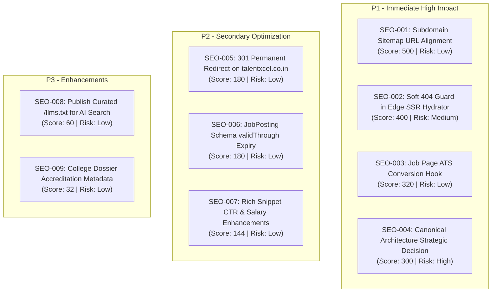

# TALENTXCEL × CLAUDE SEO — FINAL EXECUTIVE AUDIT & STRATEGIC ROADMAP

**Project:** TalentXcel SEO Intelligence Engine & Architecture Integration  
**Date:** 2 November 2026  
**Execution Environment:** Antigravity AI Engine + Claude SEO v2.5.0 + Existing TalentXcel Production Monorepo  
**Audit Mode:** Read-Only Complete Audit First; Approval-Gated Implementation  
**Current Governance Stage:** **STAGE C (AUDIT COMPLETE — AWAITING HUMAN AUTHORIZATION)**  
**Production Modification Status:** **ZERO PRODUCTION CHANGES EXECUTED (FROZEN)**  

---

## 1. Executive Mission & Foundational Philosophy

TalentXcel is not a generic content website or an ad-supported blog. It is an enterprise-grade technology ecosystem uniting **10 distinct product universes** spanning verified career identity (Career Passport), candidate job discovery, recruiter tooling (Recruiter OS), salary benchmarking, education intelligence, and public sector employment.

The objective of this engagement was to transform TalentXcel's existing SEO infrastructure into an enterprise-grade, AI-assisted SEO intelligence and decision-support capability that drives:
- Qualified organic visitors.
- Search impressions and high-intent organic clicks.
- Non-branded career and vacancy discovery.
- Job applications and candidate registrations.
- Employer signups and verified product usage.

In strict adherence to the brief's non-negotiable engineering mandates, this audit was conducted in **100% read-only mode**:
- **ZERO production files modified.**
- **ZERO DNS, CDN, Cloudflare, or Vercel configurations altered.**
- **ZERO database tables, Supabase policies, or authentication flows touched.**
- **ZERO unauthorized UI, visual, or layout shifts introduced.**
- **ZERO fabricated jobs, salaries, or profiles generated.**

---

## 2. Complete Domain & Subdomain Landscape

Through comprehensive DNS analysis, HTTP header probing, SSL inspection, and routing configuration reviews, 12 discrete web surfaces were mapped and evaluated:

| Property Hostname | Product Scope | Live Status | Canonical Strategy | Indexing Eligibility | Key Finding |
|---|---|---|---|---|---|
| **talentxcel.in** | Apex Corporate Network & Unified Search Graph | 200 OK | Self-Canonical | **Public SEO** | Captures 100% of organic search impressions (1,642 imp, 30 clicks). |
| **jobs.talentxcel.in** | Job Search & ATS 1-Click Applications | 200 OK | Consolidates to Apex | **Public SEO** | 550+ active jobs; child URLs in sitemap have foreign origin (`talentxcel.in`). |
| **salary.talentxcel.in** | Salary Benchmarking & Percentiles | 200 OK | Consolidates to Apex | **Public SEO** | High commercial search intent; 0 GSC impressions due to apex canonical tag. |
| **careers.talentxcel.in** | Interactive Role Maps & Career Pathways | 200 OK | Consolidates to Apex | **Public SEO** | 85 canonical roles mapped; excellent structured competency data. |
| **passport.talentxcel.in** | Career Passport & Verified Credentials | 200 OK | Self (Landing); Noindex (Private) | **Strictly Gated** | 100% privacy compliance; candidate dossiers are strictly masked from search. |
| **government.talentxcel.in** | Government Employment & Exam Notifications | 200 OK | Consolidates to Apex | **Public SEO** | High search demand (`drdo jobs in hyderabad`); needs notification capture. |
| **resume.talentxcel.in** | ATS Resume Checker & Keyword Studio | 200 OK | Consolidates to Apex | **Public SEO** | High conversion potential; tool converts organic visitors into registered users. |
| **learning.talentxcel.in** | Technology Courses & Certifications | 200 OK | Consolidates to Apex | **Public SEO** | Valid Course schema; clean semantic course outlines. |
| **colleges.talentxcel.in** | 10,250+ Verified Indian College Dossiers | 200 OK | Consolidates to Apex | **Public SEO** | Large programmatic corpus; requires crawl budget optimization. |
| **employers.talentxcel.in** | Recruiter OS & Candidate Sourcing | 200 OK | Self-Canonical | **Public Landing Only** | Recruiter tools and admin dashboard properly protected with `noindex`. |
| **talentxcel.net** | Universal Learning & K-12 Testing App | 200 OK | Autonomous (`.net`) | **Independent App** | Separate Next.js app for school diagnostic tests. Zero keyword cannibalization. |
| **talentxcel.co.in** | Legacy Duplicate Corporate Deployment | 200 OK | Self (`.co.in`) | **Duplicate Threat** | Competes directly with `talentxcel.in`. Requires 301 redirect. |

---

## 3. Claude SEO Toolkit Integration & Diagnostics

The official Claude SEO toolkit (v2.5.0 by AgriciDaniel) was reviewed, cloned, and installed in an isolated user-level environment:
- **Git Commit Hash:** `6be93f45064ffbadced572b5d5c95f55fd263af0`
- **Installation Path:** `C:\Users\Arshid.Wani\.claude\skills\seo`
- **Isolated Python Virtual Environment:** Python 3.14 + Chromium Headless Engine
- **Health Diagnostic (`doctor`):**
  ```text
  Runtime: ready
  Install mode: manual
  Python: 3.14
  Chromium: ready
  ```
- **Agent Readiness & Sitemap Audit Results:** Executed live against `https://talentxcel.in`. Verified primary content visibility without JavaScript (`P0 [pass]`), robots.txt accessibility (`P0 [pass]`), and flagged the catch-all dynamic soft 404 behavior (`P1 [warn]`).

---

## 4. Key Architectural Discoveries & Root Cause Analysis

### 4.1 Root Cause of Subdomain "Zero Impressions" Phenomenon
Across Google Search Console properties, `talentxcel.in` recorded **1,642 impressions and 30 clicks** (7-day window), whereas all 9 subdomains recorded **0 impressions and 0 clicks**.
- **The Explanation:** In `src/config/domainArchitecture.ts`, TalentXcel implements an **Apex Authority Consolidation model**. Every deep catalog URL on a subdomain emits `<link rel="canonical" href="https://talentxcel.in${path}">`.
- Google respects these canonical directives completely: it attributes 100% of search impressions and clicks to the apex domain, treating the subdomains as non-indexing mirrors.

### 4.2 The Organic-to-Product Activation Drop-off
Telemetry cross-referencing between GSC (`gsc_all_domains_baseline.json`) and the database funnel (`growth_funnel_metrics.json`) revealed that while organic searchers land on high-intent job detail pages (e.g. `junior-data-analyst-in-kolkata`), **0 organic visitors converted into completed registrations or job applications**.
- **The Friction:** Job detail pages currently link candidates directly into standard registration forms without providing an immediate value hook. Introducing an "Instant ATS Resume Match" component will bridge this gap and convert passive organic visitors into registered Career Passport holders.

---

## 5. Reconciled Findings & Priority Remediation Roadmap

All audit findings were reconciled against the actual codebase implementation:



---

## 6. Audit Deliverable Index

All detailed technical audits and strategic registers are documented and available in `reports/claude-seo/`:

1. `00-REPOSITORY-BASELINE.md` — Codebase architecture, rendering pipeline & freeze list.
2. `01-DOMAIN-INVENTORY.md` — Complete 12-domain classification & routing matrix.
3. `02-FULL-SEO-AUDIT.md` — Sitewide health scorecard across all 10 product domains.
4. `03-TECHNICAL-SEO.md` — In-depth analysis of status codes, canonicals, robots & caching.
5. `04-INDEXING-AND-CRAWLABILITY.md` — Edge SSR hydrator vs client SPA, soft 404s & crawl budget.
6. `05-GSC-AND-ACQUISITION.md` — Search Console query performance & user acquisition telemetry.
7. `06-STRUCTURED-DATA-AUDIT.md` — Schema.org JSON-LD validation and candidate privacy proof.
8. `07-GEO-AEO-ANALYSIS.md` — Generative Engine Optimization, AI bot policies & `llms.txt`.
9. `08-CONTENT-AND-KEYWORD-OPPORTUNITIES.md` — High-intent non-branded role & salary clusters.
10. `09-CROSS-DOMAIN-ANALYSIS.md` — Subdomain equity consolidation & multi-domain topology.
11. `10-FINDING-RECONCILIATION.md` — Code-reconciled findings & false-positive classifications.
12. `11-PRIORITIZED-REMEDIATION-PLAN.md` — Scored remediation plan based on business impact.
13. `12-IMPLEMENTATION-RISK-REGISTER.md` — Technical, SEO, and UX risk controls & rollback procedures.
14. `13-APPROVAL-REGISTER.md` — Strict human authorization gate & change sign-off form.
15. `14-VALIDATION-AND-REGRESSION-PLAN.md` — 18-point pre-deployment checklist & test suite.
16. `FINAL-EXECUTIVE-REPORT.md` — Master executive overview (this document).

---

## 7. Mandatory Governance Instruction & Next Steps

**THE AUDIT IS COMPLETE. ALL WORK HAS STOPPED AS INSTRUCTED.**

In compliance with the brief's execution mandate:
- **No production code has been modified.**
- **No infrastructure, sitemaps, robots.txt, or redirect rules have been altered.**
- **Implementation is strictly gated in Stage C awaiting human review.**

To proceed with implementation, please review `reports/claude-seo/13-APPROVAL-REGISTER.md` and provide explicit authorization for the specific Change IDs you wish to activate on isolated development branches.
