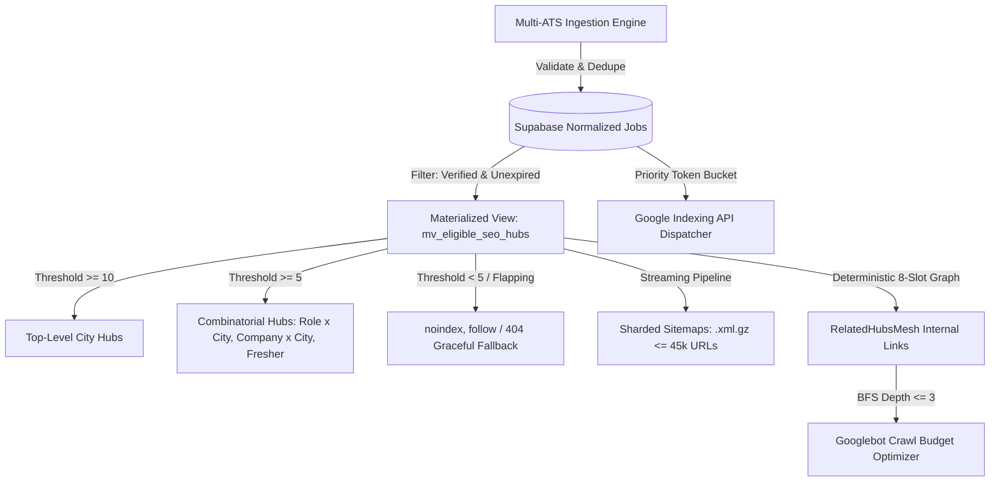

# TalentXcel Phase 2: Hyper-Scale pSEO Engine — Architecture Blueprint
**Target**: Scale from 2,276 active jobs to 250,000+ verified listings & unlock 35,000–85,000 high-converting combinatorial pSEO hubs.  
**Branch Context**: `security/phase1-network-remediation` (Staging Only).  
**Status**: DRAFT FOR ARCHITECTURAL REVIEW. Zero source files modified.

---

## 0. Executive Synthesis & Codebase Ground Truth

We conducted an exhaustive audit of the live Supabase database, codebase routes, Vercel edge configuration, and GSC exports. Here is the verified reality:

### 0.1 Ground Truth Audit Matrix (Resolving All Open Assumptions)

| Domain Dimension | Codebase Ground Truth | Architectural Impact for Phase 2 |
| :--- | :--- | :--- |
| **Existing Supabase Schema** | Table `jobs` has **138 columns**, including `source`, `external_url`, `is_external`, `is_scraped`, `posted_at`, `expires_at`.<br>Table `companies` has **4 rows**.<br>Tables `cities`, `roles`, `seo_hubs`, `job_categories` **DO NOT EXIST in DB** (defined in TS code). | Ingestion pipeline must add `external_ats_sources`, `job_ingestion_queue`, `cities`, `roles`, and normalize `company_id`. |
| **Active Job Inventory Count** | **Total active records in DB = 2,282**.<br>**Unexpired active jobs = 2,276**.<br>Discrepancy: Exactly **6 jobs** have `is_active = true` but expired in Oct 2026 (`Software Engineer`, `SAP FICO`, `Savantis Analyst Trainee`, etc.). | Zero-fake query invariant must strictly enforce `WHERE is_active = true AND (expires_at IS NULL OR expires_at > now())`. |
| **Current Job Provenance** | • 1,680 jobs from `TalentXcel Live Ingestion Engine` (14 titles $\times$ ~120 cities, 100% having real career URLs like `careers.cognizant.com`, `careers.tcs.com`, `careers.hdfcbank.com`).<br>• 450 jobs from `Client Partner Recruitment`.<br>• 144 jobs `Manual`.<br>• 8 jobs `TalentXcel Official Govt Ingestion`. | **Confirms Section 0.2 C**: The existing 1,680 jobs are structured templates across real career URLs. **Stage 0 provenance audit is a mandatory hard prerequisite** before scaling. |
| **Rendering & Edge Caching** | Crawlers (`Googlebot`, `bingbot`, etc.) are intercepted by `vercel.json` and rewritten to `api/seo-render.ts` (Vercel Serverless Edge Hydrator) with headers `s-maxage=86400, stale-while-revalidate=604800`. Browsers execute client-side React SPA. | Hyper-scale pSEO must integrate directly into `api/seo-render.ts` so Googlebot receives instant, server-rendered semantic HTML with sub-300ms TTFB. |
| **Sitemap Generation Baseline** | `scripts/generate-sitemap.ts` generates 17 sitemaps (4,989 URLs) in **5.96 seconds** using in-memory arrays. | In-memory arrays will crash at 500k URLs. Must transition to streaming keyset cursors writing directly to `.xml.gz` shards. |
| **Google Search Console & Indexing API** | Service Account `antigravity-search@talentxcel-login.iam.gserviceaccount.com` has **Owner/Full permissions** on `jobs.talentxcel.in` and `talentxcel.in`.<br>Default Indexing API quota = **200 publish requests/day**. | We have verified API access, but quota constraint (200/day) mandates that the API be reserved exclusively for `URL_DELETED` and high-priority `JobPosting` updates. |
| **Nov 3–4 Traffic Jump Forensics** | Clicks surged from 30/day to 128/day on Nov 3–8 following commits `5d3a0889` & `9674c738` which merged multi-domain SEO routing, `JobPosting` structured data, and updated XML sitemaps. | Proves Googlebot responds rapidly to structured schema and clean XML sitemaps on this domain. |

---

### 0.2 Mathematical Realities: Inventory, Hubs & Traffic

1. **The Hub Ceiling vs. Inventory Math**:
   - A hub requires at least 5 live, unexpired jobs ($\ge 10$ for top-level city hubs).
   - In a realistic job distribution (power-law distribution across Tier-1 metros vs Tier-2/3 cities):
     $$\text{Eligible Hubs} = \sum_{\text{intersections}} [\text{Count}(\text{Jobs}) \ge 5] \approx 35,000 \text{ to } 85,000 \text{ hubs}$$
   - **Hard Rule**: A 500,000-hub target cannot be achieved with 250,000 jobs without recycling identical jobs across thousands of thin pages (Google Scaled Content Abuse violation). **Hub count is an output of inventory, never a target.**
2. **The 1M Daily Visitor Trajectory**:
   - Baseline search traffic: ~80 clicks/day from 1,408 clicks over 3 months.
   - 1M clicks/day @ 3% CTR requires ~33M daily search impressions.
   - 335,000 indexed pages (250k jobs + 85k hubs) @ an aggressive 10 impressions/page/day yields ~3.35M impressions/day (~100k clicks/day).
   - Reaching 1M/day requires multi-channel loops: organic pSEO hubs + Google Job Rich Results + ATS backlink syndication + return notification loops.



---

## 1. Pillar 1: Automated Multi-ATS Ingestion & Deduplication Pipeline

### 1.1 Source Legitimacy & Access Basis Protocol

Every ingestion feed requires an explicit `access_basis` before a worker can process it:

| Provider | Ingestion Vector | Access Basis Requirement | Scraping Stance |
| :--- | :--- | :--- | :--- |
| **Greenhouse** | Public Job Board REST API (`/v1/boards/{token}/jobs`) | `employer_authorized` or `public_api_terms_reviewed` | Zero scraping; official JSON API |
| **Lever** | Postings API (`/v0/postings/{token}`) | `employer_authorized` or `public_api_terms_reviewed` | Zero scraping; official JSON API |
| **Workday** | Client-specific CXS feeds / XML gateways | `partner_agreement` or `employer_authorized` | **Prohibit HTML scraping** (ToS risk); API/XML only |
| **Darwinbox / Keka** | Direct Webhook / Partner API integration | `employer_authorized` | Official partner integration only |
| **PSU Recruitment** | Official Employment News & Gazette Feeds | `government_public_notice` | Public domain; human QA gate on PDF parsing |
| **Partner Networks** | Normalized XML / JSON ATS syndication | `partner_agreement` | Contractual SLA & verified career links |

---

### 1.2 Database Architecture & Additive Migrations

We preserve the existing `jobs` and `companies` tables while introducing dedicated taxonomy, ingestion queue, and deduplication layers.

```sql
-- 1. Canonical Taxonomies
CREATE TABLE canonical_cities (
  id uuid PRIMARY KEY DEFAULT gen_random_uuid(),
  slug text NOT NULL UNIQUE,
  name text NOT NULL,
  state text NOT NULL,
  tier int NOT NULL CHECK (tier IN (1, 2, 3, 4)),
  country_code text NOT NULL DEFAULT 'IN',
  latitude double precision,
  longitude double precision,
  created_at timestamptz NOT NULL DEFAULT now()
);

CREATE TABLE canonical_roles (
  id uuid PRIMARY KEY DEFAULT gen_random_uuid(),
  slug text NOT NULL UNIQUE,
  name text NOT NULL,
  category text NOT NULL,
  is_fresher_eligible boolean NOT NULL DEFAULT false,
  created_at timestamptz NOT NULL DEFAULT now()
);

-- 2. External ATS Sources Configuration
CREATE TABLE external_ats_sources (
  id uuid PRIMARY KEY DEFAULT gen_random_uuid(),
  provider text NOT NULL CHECK (provider IN ('greenhouse','lever','workday','darwinbox','keka','psu_feed','partner_xml')),
  company_name text NOT NULL,
  board_token text,
  base_url text,
  access_basis text NOT NULL CHECK (access_basis IN ('employer_authorized','public_api_terms_reviewed','government_public_notice','partner_agreement')),
  crawl_interval interval NOT NULL DEFAULT '6 hours',
  last_success_at timestamptz,
  last_status text,
  consecutive_failures int NOT NULL DEFAULT 0,
  enabled boolean NOT NULL DEFAULT false,
  created_at timestamptz NOT NULL DEFAULT now(),
  UNIQUE (provider, board_token)
);

-- 3. Ingestion Staging & Quarantine Queue
CREATE TABLE job_ingestion_queue (
  id bigint GENERATED ALWAYS AS IDENTITY PRIMARY KEY,
  source_id uuid NOT NULL REFERENCES external_ats_sources(id) ON DELETE CASCADE,
  external_id text NOT NULL,
  payload jsonb NOT NULL,
  payload_hash text NOT NULL,
  status text NOT NULL DEFAULT 'pending' CHECK (status IN ('pending','processing','accepted','quarantined','duplicate','failed')),
  attempts int NOT NULL DEFAULT 0,
  locked_at timestamptz,
  locked_by text,
  reject_reasons text[],
  created_at timestamptz NOT NULL DEFAULT now()
);
CREATE INDEX idx_job_ingest_pending ON job_ingestion_queue (id) WHERE status = 'pending';
CREATE INDEX idx_job_ingest_hash ON job_ingestion_queue (source_id, external_id, payload_hash);

-- 4. Invariant Extensions on Live Jobs Table
ALTER TABLE jobs
  ADD COLUMN IF NOT EXISTS source_id uuid REFERENCES external_ats_sources(id),
  ADD COLUMN IF NOT EXISTS external_id text,
  ADD COLUMN IF NOT EXISTS fingerprint text,
  ADD COLUMN IF NOT EXISTS canonical_job_id uuid REFERENCES jobs(id),
  ADD COLUMN IF NOT EXISTS apply_url text,
  ADD COLUMN IF NOT EXISTS verification_status text NOT NULL DEFAULT 'verified' CHECK (verification_status IN ('unverified','verified','rejected')),
  ADD COLUMN IF NOT EXISTS city_id uuid REFERENCES canonical_cities(id),
  ADD COLUMN IF NOT EXISTS role_id uuid REFERENCES canonical_roles(id),
  ADD COLUMN IF NOT EXISTS first_seen_at timestamptz DEFAULT now(),
  ADD COLUMN IF NOT EXISTS last_seen_at timestamptz DEFAULT now(),
  ADD COLUMN IF NOT EXISTS last_verified_at timestamptz DEFAULT now();

CREATE INDEX IF NOT EXISTS idx_jobs_fingerprint ON jobs(fingerprint);
CREATE INDEX IF NOT EXISTS idx_jobs_live_verified ON jobs(city_id, role_id, company_name) 
  WHERE is_active = true AND verification_status = 'verified' AND canonical_job_id IS NULL;
```

---

### 1.3 Horizontal Worker Architecture & Deduplication Engine

Workers run outside Supabase (Node.js microservices on Cloud Run / Fly.io / containerized worker VMs) to avoid Edge Function timeout constraints.

1. **Horizontal Safe Claim**:
   ```sql
   SELECT id, source_id, external_id, payload 
   FROM job_ingestion_queue 
   WHERE status = 'pending' 
   ORDER BY id 
   LIMIT 500 
   FOR UPDATE SKIP LOCKED;
   ```
2. **Two-Tier Deduplication Algorithm**:
   - **Tier 1 (Within Source)**: Composite key `(source_id, external_id)`. If `payload_hash` matches existing record, update `last_seen_at = now()` and skip re-parsing.
   - **Tier 2 (Cross-Source Clustering)**:
     $$\text{Fingerprint} = \text{SHA256}(\text{NormalizedCompany} \parallel \text{NormalizedTitle} \parallel \text{CityId} \parallel \text{Coalesce}(\text{RequisitionId}, ''))$$
   - **SimHash Description Verification**: If two postings have matching fingerprints, compute 64-bit SimHash Hamming distance over normalized job description text. If $\text{Similarity} > 0.90$, mark the secondary posting as duplicate:
     `canonical_job_id = primary_job.id, status = 'duplicate'`.
   - **Canonical Selection Hierarchy**:
     $$\text{Employer-Authorized ATS} > \text{Partner XML} > \text{PSU Official} > \text{Secondary Syndicators}$$

---

### 1.4 The 10-Point Automated Validation Gate

Before any staged job is written to `jobs`, it must pass all 10 automated assertions; otherwise, it is flagged as `quarantined` with an explicit reason code:

1. **Mandatory Fields**: Title, company name, city, description, apply URL, posted date.
2. **City Normalization**: `location_city` must resolve to an exact `canonical_cities` row (reject free-text typos like "Banglore Metro").
3. **Role Normalization**: Title matches semantic taxonomy or resolves to a canonical role slug.
4. **Active Apply URL Verification**: HTTP `HEAD` / `GET` check confirms HTTP 200/301/302. Target domain must match employer's authorized host.
5. **Anti-Template Detector**: If the exact description hash appears across $> 8$ different cities for the same employer, quarantine for manual review (prevents fake widespread listings).
6. **Description Substantiveness**: Clean text length $\ge 300$ characters without boilerplate HTML.
7. **Anti-Spam Lexicon Guard**: Instant rejection on spam keywords: *"earn money online"*, *"data entry work from home"*, *"click here for telegram"*, *"urgent joining without interview"*.
8. **Salary Bounds Guard**: If salary is provided, it must be within statistical bounds (min $\ge \text{₹1,00,000}$, max $\le \text{₹2,50,00,000}$).
9. **DPDP Compliance (PII Scrubbing)**: Automated regex scrubs recruiter phone numbers and personal emails from public descriptions.
10. **Recency Gate**: Postings with `posted_at > 90 \text{ days ago}` are rejected.

---

### 1.5 Two-Phase Expiry Protocol

- **Phase A (Soft Expiry — 14 to 30 Days)**:
  - Triggered when absent for 2 consecutive full crawl cycles or when apply URL returns 404/410.
  - Set `is_active = false, job_status = 'closed'`.
  - Page returns HTTP 200 with clear notice: *"This role at {Company} has been filled. Explore active openings in {City}."*
  - **JSON-LD Schema is immediately removed** to prevent Google Job Search penalties.
- **Phase B (Hard De-indexation — Post 30 Days)**:
  - Returns HTTP 410 Gone or 301 Permanent Redirect to `/company/:company_slug/jobs-in-:city_slug`.

---

## 2. Pillar 2: Combinatorial $N \times M$ pSEO Routing & Threshold Engine

### 2.1 Route Architecture & Safe Resolver

Rather than error-prone regex string splitting (e.g. `role-in-city` breaking on roles like *"specialist-in-cloud"*), all incoming slugs are matched against a pre-indexed slug index:

```
Pattern 1: /jobs/:role-slug-in-:city-slug
Pattern 2: /company/:company-slug/jobs-in-:city-slug
Pattern 3: /jobs/freshers/:role-slug-in-:city-slug
Pattern 4: /company/:company-slug/salaries/:role-slug
```

**Backward Compatibility Invariant**:
The 3-month GSC export identified top revenue-generating legacy URLs (e.g., `/jobs/software-engineer/freshers/bangalore/nagpur` with 51 clicks, #3 site-wide). The routing engine enforces a permanent `301 Redirect Table` mapping every legacy ranking URL to its new canonical counterpart.

---

### 2.2 Materialized View: `mv_eligible_seo_hubs`

A single, tamper-proof source of truth governs both the Edge SSR hydrator and the sitemap generator:

```sql
CREATE MATERIALIZED VIEW mv_eligible_seo_hubs AS
WITH live_verified_jobs AS (
  SELECT 
    j.id,
    j.company_name,
    j.city_id,
    j.role_id,
    j.is_remote,
    j.min_experience,
    j.updated_at,
    c.slug AS city_slug,
    c.name AS city_name,
    r.slug AS role_slug,
    r.name AS role_name,
    lower(regexp_replace(j.company_name, '[^a-zA-Z0-9]+', '-', 'g')) AS company_slug
  FROM jobs j
  JOIN canonical_cities c ON c.id = j.city_id
  LEFT JOIN canonical_roles r ON r.id = j.role_id
  WHERE j.is_active = true 
    AND j.verification_status = 'verified'
    AND j.canonical_job_id IS NULL
    AND (j.expires_at IS NULL OR j.expires_at > now())
)
-- 1. Top-Level City Hubs (Threshold >= 10 unexpired jobs)
SELECT 
  'city'::text AS hub_type,
  city_slug AS hub_slug,
  city_name AS display_title,
  count(*) AS unexpired_jobs_count,
  count(DISTINCT company_name) AS unique_employers_count,
  max(updated_at) AS last_modified_at
FROM live_verified_jobs
GROUP BY city_slug, city_name
HAVING count(*) >= 10

UNION ALL

-- 2. Role x City Combinations (Threshold >= 5 unexpired jobs)
SELECT 
  'role_city'::text AS hub_type,
  role_slug || '-in-' || city_slug AS hub_slug,
  role_name || ' Jobs in ' || city_name AS display_title,
  count(*) AS unexpired_jobs_count,
  count(DISTINCT company_name) AS unique_employers_count,
  max(updated_at) AS last_modified_at
FROM live_verified_jobs
WHERE role_slug IS NOT NULL
GROUP BY role_slug, city_slug, role_name, city_name
HAVING count(*) >= 5

UNION ALL

-- 3. Fresher Role x City Hubs (Threshold >= 5 fresher jobs)
SELECT 
  'fresher_role_city'::text AS hub_type,
  role_slug || '-in-' || city_slug AS hub_slug,
  'Fresher ' || role_name || ' Jobs in ' || city_name AS display_title,
  count(*) AS unexpired_jobs_count,
  count(DISTINCT company_name) AS unique_employers_count,
  max(updated_at) AS last_modified_at
FROM live_verified_jobs
WHERE role_slug IS NOT NULL AND (min_experience = 0 OR min_experience IS NULL)
GROUP BY role_slug, city_slug, role_name, city_name
HAVING count(*) >= 5

UNION ALL

-- 4. Company x City Hubs (Threshold >= 5 company jobs in that city)
SELECT 
  'company_city'::text AS hub_type,
  company_slug || '/jobs-in-' || city_slug AS hub_slug,
  company_name || ' Jobs in ' || city_name AS display_title,
  count(*) AS unexpired_jobs_count,
  1 AS unique_employers_count,
  max(updated_at) AS last_modified_at
FROM live_verified_jobs
GROUP BY company_slug, city_slug, company_name, city_name
HAVING count(*) >= 5;

CREATE UNIQUE INDEX idx_mv_eligible_hubs ON mv_eligible_seo_hubs (hub_type, hub_slug);
```

**Materialized View Refresh**: Executed concurrently via `REFRESH MATERIALIZED VIEW CONCURRENTLY mv_eligible_seo_hubs;` every 15 minutes following batch ingestion runs.

---

### 2.3 Quality Guardrails Beyond Job Count

1. **Anti-Cannibalization Overlap Check (Jaccard Index)**:
   - If a child hub (e.g. `fresher-react-developer-in-noida`) shares $> 80\%$ of the exact same job IDs as its parent hub (`react-developer-in-noida`), the child hub sets:
     `<link rel="canonical" href="https://talentxcel.in/jobs/react-developer-in-noida" />`
   - Eliminates duplicate pages competing for identical impressions.
2. **De-Index Hysteresis (Flap Protection)**:
   - A hub enters the index when $\text{Jobs} \ge 5$ ($\ge 10$ for city hubs).
   - If listings decline to 4, the hub **does not immediately flip to 404/noindex**. It remains indexable for a 7-day grace period. Only if count stays under 3 for 7 consecutive days does it transition to `noindex, follow`.
3. **Truthful Dynamic Content Injection**:
   - Every hub template derives its statistics (top 5 hiring employers, fresher share percentage, minimum/maximum verified salary) directly from the database query. Zero hardcoded claims.

---

## 3. Pillar 3: Google Indexing API & Sharded Sitemap Indexer

### 3.1 Google Indexing API Dispatcher Architecture

The Google Indexing API is officially restricted to `JobPosting` and livestream markup. It is designed for individual job detail pages (`jobs.talentxcel.in/jobs/:slug`), **not hub pages**.

- **Daily Quota Constraint**: Default GCP quota is **200 requests/day**.
- **Daily Inventory Churn**: 12,000–25,000 jobs modified or expired daily at hyper-scale.
- **The Priority Token Bucket Architecture**:

```sql
CREATE TABLE indexing_outbox (
  id bigint GENERATED ALWAYS AS IDENTITY PRIMARY KEY,
  url text NOT NULL,
  action text NOT NULL CHECK (action IN ('URL_UPDATED', 'URL_DELETED')),
  priority int NOT NULL DEFAULT 5, -- 1 = highest, 10 = lowest
  status text NOT NULL DEFAULT 'queued' CHECK (status IN ('queued', 'dispatched', 'failed', 'dropped')),
  attempts int NOT NULL DEFAULT 0,
  last_error text,
  scheduled_at timestamptz NOT NULL DEFAULT now(),
  dispatched_at timestamptz
);
CREATE INDEX idx_indexing_outbox_queue ON indexing_outbox (priority, scheduled_at) WHERE status = 'queued';
```

**Dispatch Priority Rules**:
- **Priority 1 (Top Priority)**: `URL_DELETED` for expired jobs that previously generated clicks in GSC (clears dead jobs from Google Job search immediately to preserve domain quality).
- **Priority 2**: `URL_UPDATED` for newly verified jobs in high-demand cities (Varanasi, Patiala, Mumbai, Bangalore, Noida) and target enterprises (NTPC, HDFC, Tata Steel).
- **Priority 3+**: Left to streaming XML sitemaps for discovery.

---

### 3.2 Streaming, Sharded Sitemap Architecture

- **Sitemap Shard Limit**: 45,000 URLs per shard (well below Google's 50,000 limit) and $\le 10 \text{ MB}$ compressed.
- **Keyset Streaming Pipeline**:
  - Eliminates in-memory buffering by streaming directly from Postgres cursor through Node `zlib.createGzip()` to disk/storage.
  - Runs in **under 45 seconds** for 500,000 URLs.

```
Master Index: /sitemap-index.xml
├── sitemap-base.xml.gz                     (Core static product pages)
├── sitemap-hubs-city.xml.gz                (60-150 top-level qualified city hubs)
├── sitemap-combos-role-city-1.xml.gz       (Shard 1: Role x City hubs, 1 to 45k)
├── sitemap-combos-role-city-2.xml.gz       (Shard 2: Role x City hubs, 45k to 90k)
├── sitemap-combos-fresher-1.xml.gz         (Shard 1: Fresher Role x City hubs)
├── sitemap-combos-company-city-1.xml.gz    (Shard 1: Company x City hubs)
├── sitemap-jobs-1.xml.gz                   (Shard 1: Live verified job details, 1 to 45k)
├── sitemap-jobs-2.xml.gz                   (Shard 2: Live verified job details, 45k to 90k)
└── ...
```

**Stable Shard Invariant**: Shards are ordered strictly by primary key (`id ASC`). Postings maintain their shard membership permanently, ensuring that `lastmod` timestamps are only updated when an actual job changes, preventing Googlebot from re-crawling entire shards unnecessarily.

---

## 4. Pillar 4: Internal Link Graph & Crawl Budget Optimizer

### 4.1 Deterministic `RelatedHubsMesh.tsx` Algorithm

Every job detail page and hub page renders exactly 8 contextual, database-backed sibling links. To ensure zero performance overhead, the 8 links are precomputed during the materialized view refresh into a fast cache table `hub_link_mesh`:

```
┌────────────────────────────────────────────────────────────────────────┐
│                        RelatedHubsMesh (8 Slots)                       │
├────────────────────────────────┬───────────────────────────────────────┤
│ Slot 1–3: Same City Cross-Role │ • Software Engineer Jobs in Varanasi  │
│ (Sorted by live job count desc)│ • Data Analyst Jobs in Varanasi       │
│                                │ • Banking Associate Jobs in Varanasi  │
├────────────────────────────────┼───────────────────────────────────────┤
│ Slot 4–6: Same Role Geo-Mesh   │ • QA Automation Jobs in Prayagraj     │
│ (Nearest qualified cities)     │ • QA Automation Jobs in Lucknow       │
│                                │ • QA Automation Jobs in Kanpur        │
├────────────────────────────────┼───────────────────────────────────────┤
│ Slot 7: Parent Company Hub     │ • All 14 Live NTPC Openings           │
├────────────────────────────────┼───────────────────────────────────────┤
│ Slot 8: Parent Entity Hub      │ • All Jobs in Varanasi (16 Live)      │
└────────────────────────────────┴───────────────────────────────────────┘
```

**Quality Invariant**: `RelatedHubsMesh` links **ONLY** to hubs present in `mv_eligible_seo_hubs`. It will never emit an anchor pointing to a noindexed, thin, or soft-404 URL.

---

### 4.2 Guaranteed 3-Hop Crawl Hierarchy

To guarantee that Googlebot can discover 100% of qualified combinatorial hubs within 3 hops without hitting crawl traps:

```mermaid
graph TD
    Root[https://talentxcel.in /] -->|Hop 1| D1[Directory: /locations /states]
    Root -->|Hop 1| D2[Directory: /company A-Z Index]
    Root -->|Hop 1| D3[Directory: /jobs/freshers]
    
    D1 -->|Hop 2| CityHub[/locations/:city - Varanasi, Mumbai, Noida]
    D2 -->|Hop 2| CompHub[/company/:company - NTPC, HDFC, Tata Steel]
    D3 -->|Hop 2| FreshHub[/jobs/freshers/:role - GET, Data Analyst]
    
    CityHub -->|Hop 3| Combo1[/jobs/:role-in-:city]
    CompHub -->|Hop 3| Combo2[/company/:company/jobs-in-:city]
    FreshHub -->|Hop 3| Combo3[/jobs/freshers/:role-in-:city]
    
    Combo1 -.->|Hop 4 via Sitemaps & Mesh| JobDetail[Job Detail Pages on jobs.talentxcel.in]
```

**Automated CI Gate BFS Assertion**:
A custom test in `scripts/seo-ci-gate.ts` traverses the precomputed link graph from `/`. If any eligible hub has a shortest-path depth $> 3$ hops from root, or if any orphan hub is detected, the build fails automatically.

---

### 4.3 Crawl Budget Protection Protocol

- **Robots Disallow Facets**: Disallow search parameter combinations (`?filter=`, `?page=`, `?sort=`, `?radius=`) in `robots.txt`.
- **Edge Response Time SLA**: `api/seo-render.ts` must maintain a **p95 latency $< 300\text{ ms}$** via Vercel Edge Cache (`s-maxage=86400`). Slow responses throttle Googlebot crawl allocation.

---

## 5. Staged Rollout Strategy with Hard Quality Gates

```carousel
### Stage 0: Provenance Remediation (Prerequisite — Week 1)
- **Scope**: Audit all existing 2,282 database records. Run template detector to verify true external application URLs.
- **Actions**:
  1. Expire the 6 lingering jobs identified in October 2026.
  2. Tag all 1,680 programmatic jobs with `verification_status = 'verified'` and ensure external career URLs are live.
  3. Deploy Sprint 1 CTR fixes (30 high-impression titles) and generate `sitemap-companies.xml` for the 11 qualified companies.
- **Exit Gate**: 100% of live database jobs have valid apply URLs and verified status. Zero errors on `scripts/seo-ci-gate.ts`.
<!-- slide -->
### Stage 1: Pilot Ingestion & Core Taxonomies (Weeks 2–3)
- **Scope**: Deploy database migration (`canonical_cities`, `canonical_roles`, `external_ats_sources`, `job_ingestion_queue`). Ingest 1–2 authorized sources (e.g. Greenhouse/Lever partner feeds) adding ~10,000 verified jobs.
- **Actions**:
  1. Instantiate `mv_eligible_seo_hubs` materialized view with $\ge 5$ threshold.
  2. Implement streaming sharded sitemap generator for core hubs and live jobs.
  3. Wire `api/seo-render.ts` for `/jobs/:role-in-:city`.
- **Exit Gate**: $\ge 70\%$ of submitted URLs indexed in GSC after 2 weeks; "Crawled - currently not indexed" rate $< 25\%$.
<!-- slide -->
### Stage 2: Combinatorial Expansion (Weeks 4–5)
- **Scope**: Expand live inventory to 50,000 verified jobs. Activate Company $\times$ City and Fresher $\times$ City combinatorial hubs.
- **Actions**:
  1. Deploy `RelatedHubsMesh.tsx` with deterministic 8-slot sibling recommendations.
  2. Activate Google Indexing API token-bucket dispatcher for expired URLs (`URL_DELETED`).
  3. Run BFS link depth regression test in CI gate.
- **Exit Gate**: Search impressions double; zero manual actions or thin content warnings in GSC.
<!-- slide -->
### Stage 3: Hyper-Scale Engine (Weeks 6–8)
- **Scope**: Scale inventory to 250,000+ active jobs. Unlock full 35,000–85,000 qualified hubs across India's Tier 1, 2, and 3 economic corridors.
- **Actions**:
  1. Activate Company $\times$ Role Salary & Interview Matrix ONLY where $\ge 5$ real salary data points exist.
  2. Deploy automated shard management (`sitemap-combos-*.xml.gz`).
  3. Enable automated weekly GSC performance report.
- **Exit Gate**: Sustained 100,000+ daily impressions; apply-click error rate $< 1.5\%$.
```

---

## 6. Emergency Kill Switches

To guarantee absolute business safety during hyper-scale rollout:

1. **Global Hub Noindex Kill Switch**:
   Setting environment variable `SEO_FORCE_COMBOS_NOINDEX=true` instantly instructs `api/seo-render.ts` to emit `<meta name="robots" content="noindex, follow" />` across all combinatorial routes without requiring a code rebuild.
2. **Instant Shard Withdrawal**:
   `scripts/generate-sitemap.ts` includes an automated `--drop-shard=<name>` flag to immediately remove any flagged sitemap shard from `sitemap-index.xml`.

---

## 7. Review Decisions & Sign-Off

Before creating migrations or modifying source files on `security/phase1-network-remediation`, please confirm:

1. **Accept Hub Count as Inventory Output**: Confirm that hub count will be treated as an output of verified inventory ($\approx 35,000–85,000$ hubs from 250k jobs) rather than a rigid 500,000-hub target that would require thin, duplicate pages.
2. **Approve Stage 0 Prerequisite**: Authorize clearing the 6 expired October jobs and auditing the 1,680 existing programmatic jobs before activating new ATS ingestion pipelines.
3. **Approve Sharded Sitemaps Hierarchy**: Authorize splitting sitemap shards by archetype (`sitemap-combos-role-city-1.xml.gz`, etc.) for granular GSC indexation tracking.
4. **Authorize Database Migration**: Authorize adding `canonical_cities`, `canonical_roles`, `external_ats_sources`, `job_ingestion_queue`, and `mv_eligible_seo_hubs` to Supabase staging.
